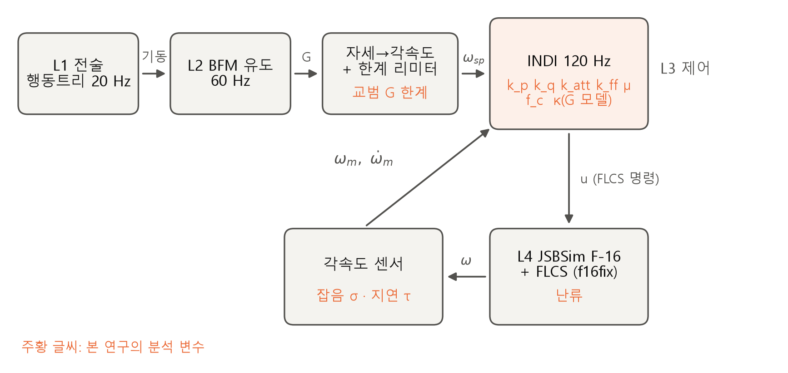
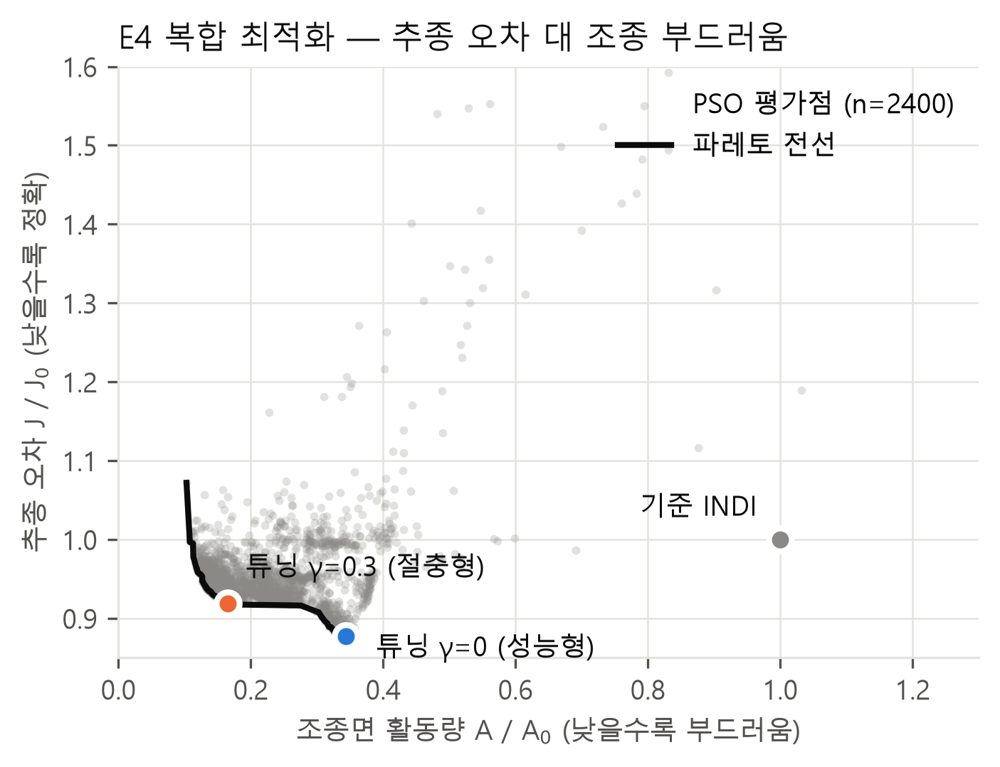
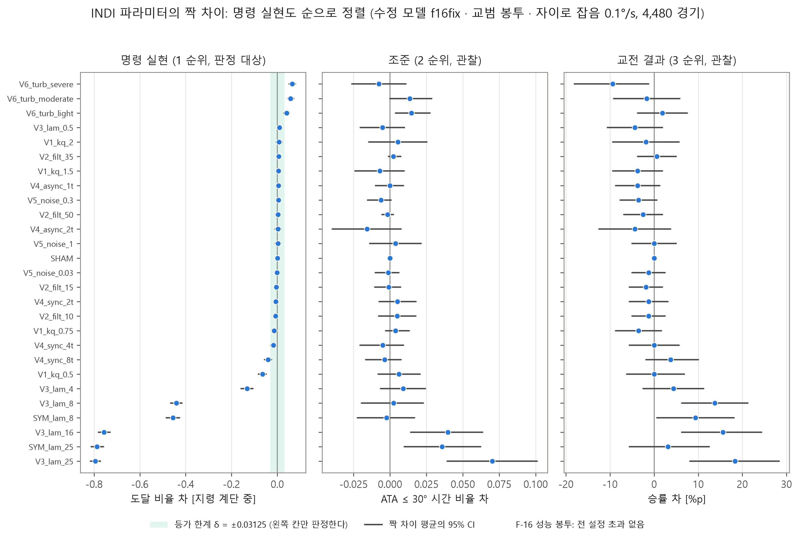
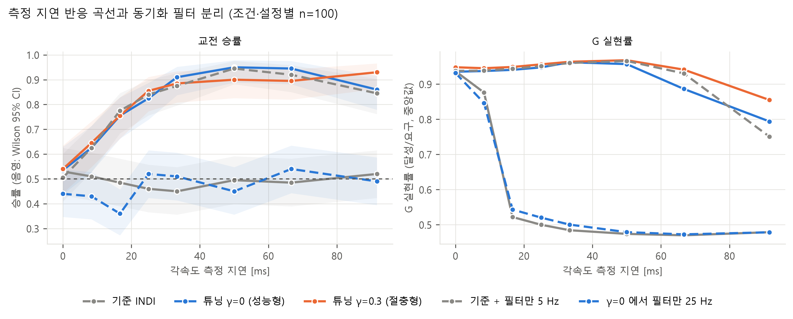
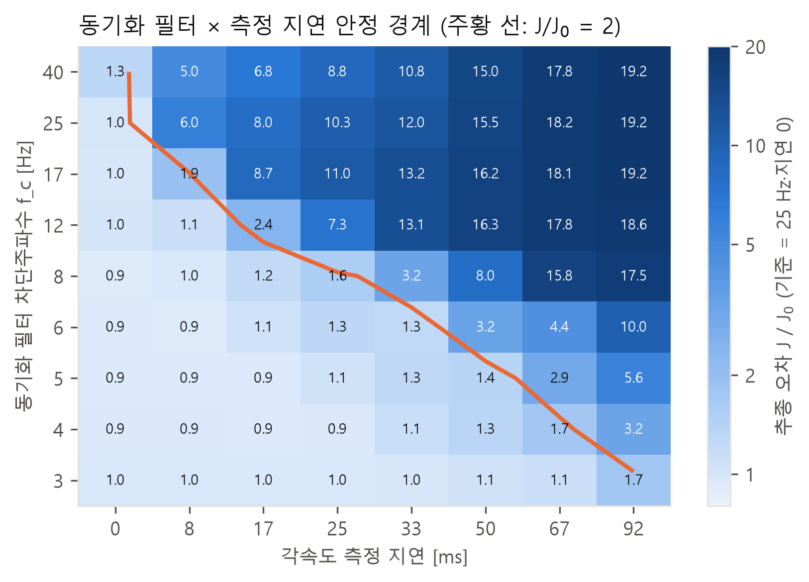

# 본론 초안 — INDI 설계·운용 변수가 F-16 도그파이트의 기동 구현과 교전에 미치는 영향

> 이 문서는 구글 문서 「두장으로 압축한 찐최종」(서론 Ⅰ장) 다음에 이어지는 Ⅱ–Ⅵ장 초안이다.
> 출처 표기: [주엽] = `STUDY.md`·`results/indi/`, [연우] = `EXPERIMENT_MASTER_20261001.md` §5.8(A36 재실행),
> [교차] = `research/indi/cross_partner.py`, `results/indi/cross_*.json`. 출처 표기는 투고본에서 지운다.
> 기호: κ = 제어효과 모델 오차(G_model/G_true), μ = 조종 증분 정칙화 계수. 참고문헌 [1]–[9]는 서론 번호를 따른다.

---

## Ⅱ. 시뮬레이션 환경과 INDI 제어기

### 2.1 교전 시뮬레이션 환경

교전 환경은 JSBSim 1.3.1의 F-16 6자유도 비행역학 모델 위에 5계층 제어 구조를 얹은 것이다(표 1, 그림 1).
전술 행동트리(L1)가 추격 방식, G 사용 수준, 조준점을 고르면, 기본전투기동(BFM) 유도 계층(L2)이 이를 교범의
G 조절, 양력벡터 배치, 추력 명령으로 바꾼다. 제어 계층(L3)은 목표 자세를 각속도 명령으로 변환하고, 기체 한계
리미터를 거친 명령을 INDI 각속도 제어기가 조종 명령으로 계산한다. 모든 계층은 120 Hz 물리 주기에 맞춰 돌고
난수는 모두 시드로 고정되어, 같은 조건의 교전은 같은 결과를 낸다.

**표 1.** 교전 환경의 계층 구성

| 계층 | 주기 | 역할 |
|---|---|---|
| L1 전술 행동트리 | 20 Hz | 추격 방식, G 사용 수준, 조준점 선택 |
| L2 BFM 유도 | 60 Hz | 교범 기반 G 조절, 양력벡터 배치, 추력 |
| L3 제어 | 120 Hz | 자세 → 각속도 명령 → 한계 리미터 → INDI |
| L4 비행역학 | 120 Hz | JSBSim F-16 (기체 내장 비행제어계 FLCS 포함) |
| L5 기록 | — | 읽기 전용 교전 기록 |

**그림 1.** 교전 환경의 계층 구조와 INDI 루프. 주황 글씨는 본 연구의 분석 변수가 들어가는 위치다.

INDI의 출력은 조종면 편향이 아니라 FLCS에 들어가는 명령이다. 따라서 INDI는 FLCS 동특성을 포함한 증강 기체를
제어한다. 제어효과 행렬 G₀는 트림점에서 각 조종 입력을 ±0.02만큼 바꿔 중앙차분으로 식별하고, 비행 중에는 동압에
비례해 조정한다(G = (q̄/q̄_ref)·G₀).

### 2.2 INDI 제어 법칙

각속도 명령 ω_sp에 대한 INDI 제어 법칙은 다음과 같다.

  ν = K(ω_sp − ω_f) + k_ff · dω_sp,f/dt                         (1)
  Δu = (GᵀG + μ·diag(GᵀG))⁻¹ Gᵀ (ν − ω̇_f)                      (2)
  u = u_f + Δu                                                   (3)

아래첨자 f는 2차 Butterworth 동기화 필터(차단주파수 f_c)를 거친 신호다. INDI는 측정한 각가속도 ω̇와 직전 조종
입력 u로 현재 상태를 대신하므로, 이 둘이 같은 시각의 값이어야 증분 계산이 맞는다[1]. 동기화 필터는 각속도,
각가속도, 조종 입력에 같은 필터를 걸어 위상을 맞춘다. 식 (2)의 μ는 Levenberg–Marquardt 형태의 정칙화로, 채널별
크기에 맞춰 조종 증분을 줄인다. 하나의 스칼라로 정칙화하면 효과가 큰 롤 채널이 크기를 지배해 요 채널이 목표에
닿지 못하므로 채널별로 두었다.

측정 지연은 두 방식으로 구분한다[연우]. **동기 지연**은 각속도·각가속도 측정과 조종 입력 되먹임 u_f를 같은 틱만큼
늦춘다. 두 신호의 시각이 맞으므로 증분 계산은 일관된다. **비동기 지연**은 측정만 늦고 u_f는 현재 값이다. 센서
경로에만 지연이 생기는 실제 상황에 해당하며, 측정과 입력의 시각이 어긋나 증분 계산이 틀어진다. 1틱은 1/120 s =
8.3 ms이다.

### 2.3 F-16 물리 한계

기체 한계는 F-16 교범[10] §4.6.5.2의 기술을 속도의 함수로 정식화하였다. 교범에 따르면 최대 받음각·최대 G에서의
선회반경은 170–330 KCAS에서 거의 일정하고, 최대 G는 440 KCAS에서 도달한다. 선회반경이 일정하면 가용 G가 속도의
제곱에, 선회율이 일정하면 속도에 비례하므로 가용 G 한계는 다음과 같다.

  G_max(V) = 6.75 (V/330)²   (V < 330 KCAS)
           = 9 V/440        (330 ≤ V < 440 KCAS)                  (4)
           = 9              (V ≥ 440 KCAS)

이 식은 350 KCAS에서 7.16 G를 주어 교범의 조준기 가정(350 KCAS, 최대 7.3 G)과 맞는다. 음의 한계는 −3 G, 롤레이트
한계는 220 °/s로 두었다. 리미터는 이 한계로 각속도 명령을 제한하고, 기록기는 실제로 **달성한** 하중배수 Nz를
매 틱 감시한다. 구조 한계(+9/−3 G)를 넘거나 식 (4)를 0.5 G 이상 넘은 경기는 실격으로 처리하였다.

### 2.4 공개 F-16 모델의 결함과 수정

초기 실험에서 아무것도 바꾸지 않은 기준 제어기가 36기체 중 28회 한계를 넘었고 최대 10.7 G에 이르렀다[주엽].
원인을 추적한 결과, 공개 JSBSim F-16 모델(1.3.1 배포판과 2026년 9월 기준 공식 저장소)의 flaperon 혼합식이 좌측을
−tef − ail, 우측을 +tef − ail로 정의해 두 값의 합이 −2·ail이 되는 부호 결함을 찾았다. 이 합이 대칭 양력과 항력
계수의 입력으로 쓰이기 때문에, 롤 명령이 곧바로 양력을 만든다. 5,000 ft, 400 KCAS에서 승강타를 고정하고
에일러론만 움직이면 우측 롤에서 −2.1 G, 좌측 롤에서 +4.1 G가 생겼다.

원 공력 자료(NASA TP-1538[11]과 이를 따르는 Stevens & Lewis의 모델)에서 수직력 계수에는 에일러론 항이 없다. 이에
우측 에일러론의 부호를 반전해 좌우 기여가 상쇄되도록 고친 모델(f16fix)을 사용하였다. 원본에서도 후연 플랩의
기여는 좌우 상쇄로 0이었으므로, 고친 모델은 롤 입력이 없을 때 원본과 같은 물리를 가진다. 수정 후 롤레이트는
좌우 ±84.7 °/s로 대칭이 되었다(원본 85.8/85.3 °/s).

이 결함은 두 계보에서 독립적으로 확인되었다. 기체 모델과 G 한계 정의를 2 × 2로 교차시킨 경기(칸당 160경기)에서,
모델만 고치면 한계 정의와 무관하게 기준 설정의 초과율이 7.5 %에서 0 %가 되고 최저 Nz가 −3.48 G에서 −1.19 G로
바뀌었다. 한계 정의만 바꾸면 초과율은 5.6 %로 거의 그대로였다[연우]. 수정 전 모델에서는 연구 변수를 하나도
주입하지 않은 적군 제어기도 교전의 24–36 %에서 한계를 넘었다. 수정 후에는 기준 설정 4,480경기 중 초과가 0건이고
최대 Nz는 7.62 G였다. 결함이 교전에서 약 2 G의 여분 하중을 만든 셈이다. 공개 모델을 쓰는 교전 연구는 이 결함을
먼저 점검해야 한다.

### 2.5 센서와 외란 모델

각속도 측정에는 백색잡음을 더하고 각가속도는 필터를 거친 차분으로 얻었다. 명목 잡음은 σ = 0.1 °/s로 두었다.
Citation II 비행시험에서 보고된 자이로 잡음(52 Hz에서 0.036 °/s)[12]을 120 Hz로 환산한 값의 약 2배이며, 전술급
광섬유 자이로의 각 랜덤워크 사양(0.07 °/√h, 120 Hz 환산 0.013 °/s)[13]보다 크다. 기체 진동이 섞인 환경을 가정한
것이다. 잡음이 없으면 동기화 필터가 걸러 낼 것이 없어 차단주파수를 바꿔도 추종이 완전히 같아지므로, 잡음 모델은
필터 효과를 관측하기 위한 필수 조건이다. 대기 난류는 JSBSim의 MIL-F-8785C Dryden 모델[14]을 약·중·강 3등급
(초과확률 10⁻², 10⁻³, 10⁻⁵)으로 시험 기체에만 걸었다.

---

## Ⅲ. 분석 변수와 평가 방법

### 3.1 분석 변수

분석 변수는 서론의 선행연구[1]–[3], [6]–[8]가 공통으로 조절한 제어이득, 필터, 지연, 제어효과 모델 불확실성을
중심으로 정하였다(표 2). 실험은 두 단계로 진행하였다. 단일 변수 실험은 한 변수만 바꾸고 나머지를 기준값으로
고정하였다. 복합 최적화는 6개 설계 변수를 동시에 조정해 변수 사이의 상호작용을 보았다. 제어 주기(120 Hz)는
비행역학 적분 주기와 묶여 있어 고정하였다. 이산 INDI의 안정 영역은 샘플링 주기가 짧을수록 넓어지며[1],
120 Hz는 강체 항공기에 충분하다는 분석이 있다[7].

**표 2.** 분석 변수와 수준

| 구분 | 변수 | 기준값 | 시험 수준 | 근거 |
|---|---|---|---|---|
| 단일 변수 | 피치 게인 배율 k_q | 1 (= 9 s⁻¹) | 0.5, 0.75, 1.5, 2 | [6]–[8] |
| | 필터 차단주파수 f_c [Hz] | 25 | 10, 15, 35, 50 | [6]–[8] |
| | 동기 지연 [틱] | 0 | 2, 4, 8 | [1], [6] |
| | 비동기 지연 [틱] | 0 | 1, 2 (+교차 실행 4) | [1] |
| | 제어효과 모델 오차 κ (피치) | 1 | 0.5, 4, 8, 16, 25 | [2], [3], [7] |
| | 자이로 잡음 σ [°/s] | 0.1 | 0.03, 0.3, 1.0 | [8] |
| | 대기 난류 | 없음 | 약, 중, 강 | [6], [7] |
| 복합 최적화 | 롤·피치 게인 k_p, k_q [s⁻¹] | 9, 9 | 4–20 | [6], [7] |
| | 필터 차단주파수 f_c [Hz] | 25 | 3–40 (로그 척도) | [6]–[8], [12] |
| | 자세 게인 k_att [s⁻¹] | 4 | 2–8 | [6] |
| | 명령 피드포워드 k_ff | 0 | 0–1 | [6], [8] |
| | 조종 증분 정칙화 μ | 0 | 0–0.5 | [8], [9] |

κ의 수준은 별도의 안정성 실험(17,316회)에서 측정한 경계값 위에 놓았다[연우]. κ를 줄이면 안정성이 먼저 무너져
κ ≈ 0.42에서 불안정해졌고, 이는 이산 INDI의 수렴 조건 κ > 0.5[1]와 거의 같다. κ를 키우면 추종이 서서히 나빠져
4.2, 8.4, 16에서 추종 오차가 각각 1.5, 2, 3배가 되었다. 시험 수준 0.5, 4, 8, 16은 이 경계들이며, 25는 지표가
차이를 잡는지 확인하는 양성 대조다. κ는 피치 행에만 걸었다. 롤 축은 큰 롤 명령에서 조종면 권한이 포화되어 INDI
파라미터로 추종을 1 % 이상 바꿀 수 없었기 때문이다.

### 3.2 평가 지표

서론에서 정의한 대로 교전을 명령 추종, 기동, 교전 결과의 세 층위로 나누어 측정하였다(표 3). 모든 지표는 교전 중
120 Hz 기록에서 계산하며, 기록기는 제어 신호를 읽기만 한다. 같은 시드의 교전 결과가 기록기 도입 전후로 같음을
확인하였다.

**표 3.** 층위별 평가 지표

| 층위 | 지표 | 정의 |
|---|---|---|
| 명령 추종 | 정상상태 도달 비 ss_ratio | 피치 명령 계단(≥ 3 °/s, 0.5 s 유지) 뒤 마지막 0.2 s의 평균 응답 / 명령 수준 |
| | 63 % 도달 비율 reach63 | 계단 0.5 s 안에 명령 변화의 63 %에 닿은 비율 |
| | G 실현률 | 요구 G ≥ 3 구간의 달성 Nz / L2 목표 G의 중앙값 |
| | 추종 상관 | 피치 명령과 응답 파형의 상관계수 |
| | 조종면 활동량 | 틱 간 조종 명령 변화량 절댓값의 평균 |
| 기동 | 조준 비율 | 자기 기수와 표적 사이 각(ATA) ≤ 30°인 시간 비율 |
| | 공세·수세 비율 | 자기 ATA < 60°이고 상대 ATA > 120°인 시간 비율(수세는 반대) |
| | 에너지 우위 | 비에너지(h + V²/2g) 차이의 시간 평균 |
| | WEZ 누적 진입률 | t초 안에 무기 교전 영역(WEZ)에 처음 들어간 경기 비율 |
| 교전 결과 | 승률, HP 차 | 승 1, 무 0.5, 패 0 / 최종 체력 차 |

계단 응답의 상승시간(t63)은 보조 지표로만 쓴다. 외란이나 진동이 응답을 흔들면 응답이 63 % 선을 우연히 일찍
통과해, 성능이 나빠졌는데도 빨라진 것처럼 보이기 때문이다(4.4절). 정상상태 도달 비와 G 실현률은 이런 왜곡을
받지 않는다. 조준 도달 시간은 WEZ에 끝내 들어가지 못한 경기를 경기 종료 시각으로 채우면 편향이 생기므로, 시간
대신 누적 진입률로 비교한다.

### 3.3 교전 조건과 실험 구성

교전 시간은 300 s이고, WEZ는 기수 기준 30° 원뿔, 거리 500–3,000 ft이다. 청군의 전술 행동트리는 고정하고 INDI
설정만 바꾸었다. 적군은 전술이 서로 다른 5종이며 모두 기준 INDI를 쓴다. 시나리오는 정면 교차, 공세 개시, 수세 개시,
중립 개시를 공통으로 하였다. 두 계보는 청군 전술 트리가 다르며(표 4), 이를 일반화 검증에 활용하였다.

**표 4.** 실험 구성

| 실험 | 내용 | 규모 | 출처 |
|---|---|---|---|
| X1 단일 변수 | 표 2 단일 변수 25설정 + 대칭 2설정, 청군 트리 T_a | 설정당 160 대응 쌍, 4,480경기 | [연우] |
| X2 복합 최적화 | 입자군집최적화(PSO), 비용 J/J₀ + γ·A/A₀, γ ∈ {0, 0.1, 0.3, 1} | 2,400 평가 | [주엽] |
| X3 교전 비교 | 기준 대 최적 설정, 명목·잡음·지연·κ·난류 조건, 청군 트리 T_b | 조건당 100–325 대응 쌍 | [주엽] |
| X4 지연 분석 | 지연 8수준 반응 곡선, 필터 분리, 필터 × 지연 안정 지도 | 지연·설정당 100 대응 쌍, 벤치 72칸 | [주엽] |
| X5 대칭·비대칭 | κ 양측 주입, 청군 단독 지연, 양측 튜닝 | 조건당 100–160 대응 쌍 | [연우][주엽] |
| X6 교차 실행 | 두 배터리에서 상대 계보의 지표로 비동기 지연 재측정 | 780경기 | [교차] |

T_a = 기본 전술 트리, T_b = 에너지 전투 트리. 일반화 실험에서는 T_b 외에 트리 두 종을 더 시험하였다.

### 3.4 통계 방법

모든 비교는 대응 설계다. 같은 (적군, 시나리오, 시드) 조합에서 기준 설정과 비교 설정의 경기를 모두 치르고, 초기
조건과 잡음·난류 시드를 공유하여 차이가 설정에서만 생기게 하였다. 통계량은 짝 차이의 평균과 부트스트랩 95 %
신뢰구간(CI)이다.

명령 추종 층위에서는 **등가 판정**을 썼다[연우]. "차이가 없다"를 주장하려면 유의하지 않다는 것만으로는 부족하기
때문이다. 지표마다 판정 기준선 δ를 미리 정하고, CI가 [−δ, +δ] 안에 있으면 "차이 없음", CI가 δ를 완전히 넘으면
"차이 있음", 그 밖은 "판정 불가"로 하였다. δ는 물리적으로 구별할 수 없는 가짜 짝(κ = 1 + 10⁻⁶)의 차이 분포 95번째
백분위수의 2배와 실용 하한(도달 비율 1/32, 정상상태 비 0.01, 시간 1틱) 중 큰 값이다. 교전은 작은 차이도 300초 동안
증폭되는 혼돈계이므로, 가짜 짝의 차이가 이 실험의 분해능 바닥이 된다. δ는 탐색 실행(2,080경기)으로 정하고,
판정은 시드가 겹치지 않는 확증 실행에서만 하였다. 양성 대조(κ = 25)는 모든 지표에서 "차이 있음", 가짜 짝은 모든
지표에서 "차이 없음"으로 판정되어 판정 체계가 정상 작동함을 확인하였다.

기동과 교전 결과 층위에서는 승점 차에 부호 검정, HP 차에 Wilcoxon 부호순위 검정을 쓰고, 한 조건의 과정 지표
12개를 한 가족으로 보아 Holm 방법으로 다중 비교를 보정하였다. 승률 구간은 Wilson 방법으로 구하였다.

---

## Ⅳ. 결과

### 4.1 단일 변수가 명령 실현에 주는 영향

명목 조건에서 단일 변수 판정 결과는 표 5와 같다[연우]. 명령 실현을 δ 이상 바꾸는 변수는 제어효과 모델 오차 κ,
피치 게인의 감소, 동기 지연이었다. 동기화 필터(10–50 Hz)와 자이로 잡음(0.03–0.3 °/s)은 세 지표 모두에서 "차이
없음"으로 판정되었다. 이는 측정이 부족했다는 뜻이 아니라, 차이가 δ 안에 든다고 적극적으로 판정했다는 뜻이다.

**표 5.** 단일 변수의 명령 실현 판정 (4,480경기, 설정당 160 대응 쌍, 기준 대비 짝 차이 평균)

| 변수 | 수준 | 도달 비율 reach63 (δ 0.031) | 정상상태 비 (δ 0.01) | 등가 지연 [s] (δ 0.0083) |
|---|---|---|---|---|
| κ | 0.5 | +0.009 없음 | −0.001 없음 | −0.009 불가 |
| | 4 | −0.132 **있음** | −0.029 **있음** | +0.061 **있음** |
| | 8 | −0.440 **있음** | −0.070 **있음** | +0.127 **있음** |
| | 16 | −0.757 **있음** | −0.098 **있음** | +0.226 **있음** |
| | 25 | −0.794 **있음** | −0.158 **있음** | +0.292 **있음** |
| k_q | 0.5 | −0.065 **있음** | −0.042 **있음** | +0.063 **있음** |
| | 0.75 / 1.5 / 2 | 없음 / 없음 / 없음 | 불가 / 없음 / 불가 | **있음** / **있음** / 불가 |
| f_c | 10 / 15 / 35 / 50 Hz | 전부 없음 | 전부 없음 | 전부 없음 |
| 동기 지연 | 2 / 4 / 8틱 | 없음 / 없음 / 불가 | 불가 / **있음** / **있음** | 불가 / **있음** / **있음** |
| 비동기 지연 | 1 / 2틱 | 없음 / 없음 | 없음 / 불가 | 없음 / 불가 |
| σ | 0.03 / 0.3 °/s | 전부 없음 | 전부 없음 | 전부 없음 |
| | 1.0 °/s | 없음 | −0.022 **있음** | 없음 |
| 난류 | 약 / 중 / 강 | 불가 / **있음** / **있음** | 없음 / **있음** / **있음** | 없음 / 불가 / **있음** |

κ의 영향이 압도적이었다. κ = 25에서 도달 비율이 0.79 떨어져, 기준에서 명령 계단의 93 %가 63 %까지 닿던 응답이
약 14 %로 줄었다. 이는 δ의 25배다. 피치 게인은 낮출 때만 영향이 컸고, 높일 때는 상승시간만 줄었다. 비동기
지연 1·2틱의 "차이 없음"은 4.4절에서 다시 다룬다. 이 판정은 계단 도달 지표의 한계와 경계 이하의 지연 수준이
겹친 결과이며, 다른 지표로는 같은 지연에서 큰 저하가 보인다.

### 4.2 복합 최적화

6개 변수를 함께 조정한 PSO는 γ별 600회, 총 2,400회 평가에서 한계 실격이 한 건도 없었다(표 6). 모든 γ의
최적해가 기준 설정보다 추종 오차와 조종면 활동량이 동시에 작았다(그림 2). 기준 설정은 파레토 전선에서 멀리
떨어져 있어, 두 목표 사이의 절충 없이 개선할 여지가 있었다.

**표 6.** γ별 최적해 (J₀ = 0.2289, A₀ = 0.04206)

| γ | J/J₀ | A/A₀ | k_p | k_q | f_c [Hz] | k_att | k_ff | μ |
|---|---|---|---|---|---|---|---|---|
| 0 (성능형) | 0.877 | 0.344 | 20.0 | 12.1 | 5.1 | 8.00 | 0.03 | 0.14 |
| 0.1 | 0.919 | 0.237 | 18.5 | 10.2 | 7.9 | 3.05 | 0.25 | 0.33 |
| 0.3 (절충형) | 0.919 | 0.165 | 6.5 | 10.0 | 4.3 | 2.42 | 0.28 | 0 |
| 1 | 0.936 | 0.135 | 4.9 | 9.6 | 3.4 | 2.00 | 0.42 | 0 |

**그림 2.** 복합 최적화의 평가점과 파레토 전선. 기준 INDI(회색)는 전선에서 멀리 떨어져 있다. 교전 실험에 쓴
성능형(γ = 0)과 절충형(γ = 0.3)을 표시하였다.

전선은 두 갈래였다. 고게인 갈래는 추종 오차를 12 % 줄였고, 저게인·피드포워드 갈래는 추종 오차를 8 % 줄이면서
조종면 활동량을 84 % 줄였다. 동기화 필터 차단주파수는 모든 해에서 3–8 Hz로 모였다. 기준값 25 Hz의 1/3–1/8이며,
Citation II 비행시험에 쓰인 3.2 Hz[12]와 같은 범위다.

변수 사이의 상호작용도 뚜렷했다. 피드포워드 k_ff를 단독으로 켜면 25 Hz 필터를 통과한 명령 미분이 계단처럼
갱신되는 명령의 고주파를 그대로 전해 추종 오차가 3배 이상 커졌다. 그러나 복합 최적화는 k_ff = 0.28을 4.3 Hz
필터와 함께 골랐다. 한 변수씩 바꾸는 실험으로는 도달할 수 없는 조합이며, 복합 최적화가 필요한 이유다. 탐색 상한에
닿은 k_p와 k_att의 범위를 2배로 넓혀 다시 탐색했을 때도 J/J₀는 0.882로 같은 수준이었다.

### 4.3 명목 조건에서 교전으로의 전달과 상충

명목 조건(잡음 0.1 °/s, 지연 없음)에서 튜닝은 명령 추종 층위를 유의하게 바꾸었다(표 7). 절충형은 롤·피치 추종
오차를 25 %, 11 % 줄이고 조종면 활동량을 83–88 % 줄였다(Holm 보정 p < 0.001). 그러나 공세 위치 비율, 에너지
우위, WEZ 체류는 기준과 차이가 없었고, 325 대응 쌍의 승률은 0.491에서 0.515–0.540으로 유의하지 않았다(부호 검정
p = 0.17–0.29). 단일 변수 실험에서도 결과는 같았다. κ와 난류를 제외한 나머지 19개 설정에서 명령 실현의 변화가 조준과
승률로 전달되지 않았다(그림 3)[연우]. 기준 제어기가 이미 전술층의 요구를 충족하므로, 추가 개선이 기동을 바꾸지
못한 것으로 해석된다.

**표 7.** 명목 조건의 층위별 결과 (100–325 대응 쌍, 굵게 = Holm 보정 p < 0.05)

| 층위 | 지표 | 기준 | 성능형 | 절충형 |
|---|---|---|---|---|
| 명령 추종 | 피치레이트 추종 RMSE [°/s] | 1.55 | 1.54 | **1.37** |
| | 롤레이트 추종 RMSE [°/s] | 16.5 | **31.3** | **12.4** |
| | G 실현률 | 0.937 | 0.934 | **0.946** |
| 기동 | 공세 위치 비율 | 0.013 | 0.015 | 0.012 |
| | 에너지 우위 [ft] | −144 | −152 | −7 |
| | WEZ 체류 [s] | 1.12 | 1.12 | 1.15 |
| 교전 결과 | 승률 | 0.491 | 0.540 | 0.515 |

**그림 3.** 단일 변수 설정별 짝 차이(4,480경기)[연우]. 왼쪽부터 명령 실현(도달 비율), 조준(ATA ≤ 30° 비율),
승률이며, 명령 실현 크기순으로 정렬하였다. 음영은 등가 기준선 δ다. 대부분의 설정은 세 층위 모두 0 근처에 있고,
κ와 난류만 움직인다.

전달이 일어난 두 경우는 방향이 서로 반대였다. 난류는 정방향이었다. 강한 난류에서 정상상태 도달 비가 0.979에서
0.870으로 떨어지고 승률이 9.4 %p 낮아졌다. κ는 역방향이었다. κ = 25에서 명령 실현은 크게 나빠졌는데 조준 비율은
+0.070, 승률은 +18.3 %p 올랐고, 60초 안에 WEZ에 들어간 경기가 26.2 %에서 50.0 %로 늘었다[연우]. 제어기가 명령을
따르지 못하는데 교전 성과가 좋아진 것이다. 서론 1.4절이 예상한 "제어 계층과 교전 성과 사이의 상충"이 실제로
나타난 사례이며, 그 원인은 4.5절의 대칭 실험으로 밝힌다.

### 4.4 측정 지연과 동기화 필터

**지연 반응 곡선.** 측정 지연(비동기)을 0–92 ms 8수준으로 바꾼 결과, 기준 INDI는 8 ms에서 G 실현률이 0.88로
떨어지기 시작해 17 ms에서 0.52로 무너졌다(그림 4, 표 8). 무너진 제어기는 피치 축이 진동하면서 요구 G의 절반만
실현하였다. 반면 성능형과 절충형은 67 ms까지 G 실현률 0.89–0.97을 유지하였다. 기준 제어기의 붕괴 임계(8–17 ms)는
비행시험에서 보고된 측정 지연(30–90 ms)[12], [15]보다 훨씬 짧다. 디지털 비행제어의 시간지연은 F-16 등의
비행시험에서 조종사 유발 진동의 원인으로 지목되어 왔다[16]. 다만 그 지연은 명령 경로에 있었던 반면, 여기서의
지연은 되먹임 경로에 있어 폐루프 안정성에 직접 작용한다.

**그림 4.** 측정 지연에 따른 승률(왼쪽, 음영은 Wilson 95 % CI)과 G 실현률(오른쪽). 점선은 필터 분리 설정이다.
필터만 5 Hz로 낮춘 기준 설정(filt5)은 튜닝 설정과 같은 곡선을, 튜닝 설정에서 필터만 25 Hz로 되돌린 설정(g0_f25)은
기준 설정과 같은 붕괴를 보인다.

**표 8.** 측정 지연에 따른 G 실현률과 승률 (양측 같은 지연, 지연·설정별 100 대응 쌍)

| 설정 | 지표 | 0 | 8 | 17 | 33 | 50 | 92 ms |
|---|---|---|---|---|---|---|---|
| 기준 | G 실현률 | 0.94 | 0.88 | 0.52 | 0.48 | 0.47 | 0.48 |
| | 승률 | 0.53 | 0.51 | 0.49 | 0.45 | 0.50 | 0.52 |
| 성능형 | G 실현률 | 0.94 | 0.94 | 0.94 | 0.96 | 0.96 | 0.79 |
| | 승률 | 0.54 | 0.63 | 0.76 | 0.91 | 0.95 | 0.86 |
| 절충형 | G 실현률 | 0.95 | 0.95 | 0.95 | 0.96 | 0.97 | 0.86 |
| | 승률 | 0.54 | 0.65 | 0.76 | 0.89 | 0.90 | 0.93 |
| filt5 | G 실현률 | 0.94 | 0.94 | 0.94 | 0.96 | 0.97 | 0.75 |
| g0_f25 | G 실현률 | 0.93 | 0.85 | 0.54 | 0.50 | 0.48 | 0.48 |

**필터 분리.** 지연 강건성의 원인은 동기화 필터 대역이었다. 기준 설정에서 필터만 25 Hz에서 5 Hz로 바꾼 filt5는
50 ms까지 튜닝 설정과 G 실현률과 승률이 사실상 같았다. 거꾸로 성능형 해에서 필터만 25 Hz로 되돌린 g0_f25는 기준
설정처럼 17 ms에서 무너졌다. 낮은 필터 대역은 지연 강건성의 충분조건이자 필요조건이었고, 나머지 다섯 변수는
필터 없이 지연 강건성을 만들지 못했다. 92 ms의 큰 지연에서는 G 실현률이 절충형 0.86, 성능형 0.79, filt5 0.75
순이어서, 저게인과 피드포워드의 조합이 지연 여유를 조금 더 넓혔다.

**안정 지도.** 필터 대역과 허용 지연의 관계를 설계 지침으로 만들기 위해, 게인을 기준값에 고정하고 차단주파수
9수준(3–40 Hz)과 지연 8수준(0–92 ms)의 격자에서 추종 오차를 측정하였다(그림 5). 추종 오차가 지연 없는 기준의
2배를 넘는 경계는 차단주파수에 반비례하였다. 허용 지연은 25 Hz에서 약 5 ms, 12 Hz에서 약 15 ms, 8 Hz에서 약
27 ms, 5 Hz에서 약 58 ms였고, 3 Hz에서는 92 ms에서도 경계를 넘지 않았다. 허용 지연과 차단주파수의 곱은
0.15–0.3으로 일정하여

  τ_max ≈ (0.15–0.3) / f_c                                       (5)

의 관계가 성립한다. 2차 Butterworth 필터의 저주파 군지연이 √2/(2πf_c) ≈ 0.225/f_c이므로, 측정 지연이 필터 자체의
군지연 수준을 넘으면 루프가 불안정해진다고 해석할 수 있다. 지연이 없을 때 차단주파수를 3–6 Hz로 낮춰도 추종
손실은 없었다(J/J₀ 0.9–1.0). 이는 4.1절에서 필터가 명목 명령 실현을 바꾸지 않는다는 판정과 일치한다.

**그림 5.** 동기화 필터 차단주파수와 측정 지연에 따른 추종 오차 J/J₀(기준: 25 Hz, 지연 0). 주황 선은 J/J₀ = 2
경계로, 허용 지연이 차단주파수에 반비례한다.

**두 배터리 교차 확인.** 4.1절에서 비동기 지연 2틱은 명령 실현에 "차이 없음"이었으나, 위 결과에서는 같은 크기의
지연이 기준 제어기를 무너뜨렸다. 두 결과를 맞추기 위해 각 배터리에서 상대 계보의 지표를 함께 측정하였다(표 9).
두 계보의 지연 구현은 같은 비동기 방식이다.

**표 9.** 청군 단독 비동기 지연의 교차 측정 (경기별 값의 중앙값)

| 배터리 | 설정 | n | 승률 | reach63 | t63 [s] | 정상상태 비 | 추종 상관 | G 실현률 |
|---|---|---|---|---|---|---|---|---|
| T_b | 기준, 0 ms | 50 | 0.48 | 0.95 | 0.142 | 0.99 | 0.89 | 0.94 |
| | 기준, 17 ms | 50 | 0.25 | 1.00 | 0.094 | 0.74 | 0.17 | 0.53 |
| | 기준, 33 ms | 50 | 0.31 | 1.00 | 0.092 | 0.35 | 0.06 | 0.48 |
| | 절충형, 17 / 33 ms | 50 / 50 | 0.61 / 0.52 | 0.94 | 0.092 | 0.98 | 0.92 | 0.95 |
| T_a | 기준, 0 ms | 80 | 0.49 | 0.93 | 0.142 | 0.98 | 0.94 | 0.91 |
| | 기준, 17 ms | 80 | 0.32 | 0.94 | 0.123 | 0.98 | 0.68 | 0.90 |
| | 기준, 33 ms | 80 | 0.20 | 1.00 | 0.092 | 0.83 | 0.17 | 0.53 |
| | filt5, 0 ms | 80 | 0.48 | 0.91 | 0.196 | 0.95 | 0.93 | 0.91 |
| | filt5, 17 ms | 80 | 0.48 | 0.89 | 0.167 | 0.96 | 0.93 | 0.91 |
| | filt5, 33 ms | 80 | 0.43 | 0.92 | 0.142 | 0.96 | 0.93 | 0.91 |

두 배터리 모두에서 기준 제어기는 비동기 지연으로 무너졌다. 무너지는 지연은 T_b에서 17 ms, T_a에서 17–33 ms
사이였다. T_a의 17 ms에서 G 실현률은 0.90으로 유지됐지만 추종 상관이 0.94에서 0.68로 떨어지고 승률이 0.49에서
0.32로 낮아져, 붕괴 경계 바로 아래에 있었다. 단일 변수 실험의 비동기 지연은 2틱까지만 시험해 이 경계에 닿지
않았다.

T_a에서도 필터만 5 Hz로 낮추면 붕괴가 사라졌다. filt5의 G 실현률은 0, 17, 33 ms에서 모두 0.91, 추종 상관은
0.93이었고, 33 ms 승률은 0.43으로 기준 제어기의 0.20보다 높았다. 대가는 지연이 없을 때의 상승시간으로, 0.142 s에서
0.196 s로 늘었다. 이로써 "지연 강건성은 동기화 필터 대역이 정한다"는 결론이 네 번째 전술 트리에서도 재현되었다.

더 중요한 관측은 지표의 행동이다. 제어기가 무너져 피치 축이 진동할 때 도달 비율은 1.00, 상승시간은 0.09 s로
오히려 좋아 보였다. 진동하는 응답이 63 % 선을 우연히 일찍 통과하기 때문이다. 같은 경기에서 정상상태 비는
0.35–0.83, 추종 상관은 0.06–0.17, G 실현률은 0.48–0.53으로 붕괴를 정확히 보였다. 이 현상은 단일 변수 실험에서
난류가 상승시간을 0.142 s에서 0.108 s로 줄이면서 정상상태 비를 0.979에서 0.870으로 떨어뜨린 것과 같은
구조다[연우]. 따라서 반응 속도를 상승시간만으로 평가하면 외란과 진동에 속는다. 명령 실현은 정상상태 도달 비와
G 실현률로 판단해야 한다.

### 4.5 상대적 우위와 절대적 강건성

교전 성과는 상대가 있는 양이다. 청군만 바꾼 실험에서 승률이 올랐다면, 청군이 절대적으로 강해졌는지 상대보다
달라졌을 뿐인지 구분할 수 없다. 이를 가르기 위해 두 종류의 대조 실험을 하였다(표 10).

**표 10.** 청군 단독 조건과 대칭 조건의 비교

| 효과 | 조건 | 청군 명령 실현 | 조준 비율 | 승률 | 해석 |
|---|---|---|---|---|---|
| κ = 25 [연우] | 청군만 | 도달 비율 −0.794 | +0.070 | +18.3 %p | |
| | 양측 같은 κ | 도달 비율 −0.787 | +0.036 | +3.1 %p | 차이 −15.2 %p [−25.0, −5.0] → **상대적 우위** |
| 지연 17 ms [주엽] | 양측 같은 지연 | 기준 G 실현률 0.52 | — | 0.49 → 0.76 (튜닝) | |
| | 청군만 지연 | 기준 G 실현률 0.54 | — | 0.21 → 0.52–0.55 (튜닝) | 청군 붕괴 방지 → **절대적 강건성** |
| 지연 33 ms [주엽] | 양측 튜닝, 양측 지연 | — | — | 기준 청군 0.27 → 튜닝 청군 0.52–0.57 | 대등 회복 |

**κ의 이득은 상대적이다.** 적군에게도 같은 κ를 주면 청군의 명령 실현 저하는 그대로인데(차이 +0.003, CI가 0 포함),
조준 이득(−0.035 [−0.062, −0.008])과 승률 이득(−15.2 %p)은 사라졌다[연우]. κ가 만드는 것은 청군의 명령 실현
저하뿐이고, 교전 이득은 적군과 다르게 움직이는 데서 오는 상대적 효과다. "모델 오차를 키우면 이긴다"는 공학적
함의는 성립하지 않는다.

**지연 튜닝의 이득은 절대적이다.** 청군에만 17 ms 지연을 주고 적군(기준 INDI)은 지연 없이 둔 비대칭 실험에서,
기준 청군은 G 실현률 0.54로 무너져 승률이 0.21로 떨어졌다(지연 없을 때 0.53). 튜닝 청군과 filt5는 G 실현률
0.93–0.95를 유지하며 승률 0.52–0.55, 즉 지연이 없을 때의 대등 수준을 지켰다(Δ승점 +0.31–0.34, Holm 보정
p < 0.001). 수세 위치 비율은 0.22에서 0.03으로, WEZ 체류는 0.34 s에서 1.06–1.15 s로 바뀌었다. 양측이 모두 튜닝
제어기를 쓰는 조건에서도 33 ms 지연에서 튜닝하지 않은 청군만 승률 0.27로 떨어졌다. 즉 튜닝은 상대를 압도하는
성능을 만드는 것이 아니라, 지연 때문에 자기 기체가 무너지는 취약성을 없앤다.

지연이 커질수록 승점 효과는 줄었다. 청군 단독 33 ms에서는 절충형만 Holm 보정 후 유의하였고(+0.20, p = 0.018),
92 ms에서는 모두 유의하지 않았다. 튜닝 설정의 G 실현률은 92 ms에서도 0.91–0.94였으므로, 이는 튜닝 설정의 붕괴가
아니라 지연된 상태 정보로 지연 없는 상대와 싸우는 불리함 때문으로 보인다.

### 4.6 물리 한계 준수

수정 모델에서 복합 최적화 2,400회와 [주엽] 교전 약 12,000경기의 실격은 없었다. 단일 변수 실험 4,480경기에서는
기준 설정의 초과가 0건이었고, 기준 대비 초과 비율이 유의하게 높은 설정도 없었다[연우]. 절대 초과는 강한 난류
(1.9 %, 최대 Nz 9.26 G)와 양측 κ = 25(1.2 %)에서만 일시적으로 나타났다. 난류는 외부 교란이므로 제어 변수의
효과로 볼 수 없다. 따라서 4.2–4.5절의 성능 변화는 한계를 넘는 비현실적 기동에서 온 것이 아니다. 그 밖의 예외는
지연으로 발산하는 기준 제어기(최대 +10.2 G)와 음의 G 기동이 많은 전술 트리에서의 −3 G 일시 초과(0.03–0.22 G)였다. 후자는 달성 Nz를
되먹임해 명령 상한을 낮추는 보호 기능으로 12건 중 11건이 해소되었다. 리미터는 각속도 명령을 제한할 뿐 달성 하중을
직접 제한하지 않으며, 제어 루프 자체가 불안정하면 보호 기능으로도 한계를 지킬 수 없다.

---

## Ⅴ. 논의

**제어 계층의 변화는 조건부로 교전에 전달된다.** INDI 파라미터는 항상 명령 실현을 바꾸었지만, 그 변화가 기동과
교전 결과로 이어진 것은 세 경우뿐이었다. 기준 제어기가 지연으로 무너질 때(정방향, 큰 효과), 난류가 실현도를
떨어뜨릴 때(정방향), 그리고 κ가 청군과 적군을 다르게 만들 때(역방향, 상대적)이다. 명목 조건에서 추종 오차
8–12 % 개선은 교전 결과를 바꾸지 못했다. 동압 스케줄과 동기화 필터를 이미 갖춘 INDI를 다듬을 때 교전상의 한계
효용이 작은 것은 자연스럽다. 계층형 강화학습 연구[9]에서 보고된 큰 효과는 비행제어 구조를 통째로 바꾼 비교였다.
따라서 제어기 튜닝의 교전상 가치는 명목 성능보다 운용 조건 변화에 대한 여유로 평가해야 한다.

**동기화 필터의 역할은 지연 유무에 따라 달라진다.** 명목 조건에서 필터 대역(10–50 Hz)은 명령 실현을 바꾸지 않았다(4.1절). 그러나
측정 지연이 있으면 필터 대역이 지연 강건성을 결정하였다(4.4절). 두 결과는 모순이 아니다. 필터의 위상 지연은
지연이 없을 때 성능에 드러나지 않지만, 측정 지연이 생기면 τ_max ≈ (0.15–0.3)/f_c의 여유로 작동한다. 복합 최적화가
지연 조건 없이 잡음만 있는 상태에서 필터를 4–5 Hz로 낮춘 결과가 지연 여유까지 확보한 것도 이 때문이다. 필터만 바꾼 설정은 두 계보의 배터리 모두에서 33 ms 지연의 붕괴를
막았다(표 9). 다만 지연이 없을 때 상승시간이 0.142 s에서 0.196 s로 늘어나는 대가가 있다. 설계
지침은 단순하다. 측정 잡음이 허용하는 범위에서 동기화 필터 대역을 예상 지연에 맞춰 식 (5)로 정하면 된다.

**반응 속도는 상승시간만으로 판단할 수 없다.** 서론에서 제기한 "명령을 얼마나 빠르고 정확하게 구현하는가"를
재기 위해 계단 응답의 상승시간이 자연스러운 지표로 보이지만, 난류와 지연 진동 모두에서 상승시간은 오히려
짧아졌다. 명령 실현은 정상상태 도달 비, 추종 상관, G 실현률을 함께 보아야 한다. 이 관측은 기체 모델(원본과 수정),
전술 트리(T_a와 T_b), 교란 종류(난류와 지연)를 바꿔도 재현되었다.

**모델 오차와 교전 이득의 관계는 주의해서 해석해야 한다.** κ가 큰 제어기는 명령을 따르지 못하지만 기수를
일찍 돌려 조준과 승률이 좋아졌다. 이 이득은 대칭 조건에서 사라졌으므로 제어기의 장점이 아니다. 청군만 바꾼
실험의 승률 상승을 제어기 개선으로 해석하면 잘못된 공학적 함의를 얻는다. 반대로 지연 튜닝의 이득은 청군 단독
지연 조건에서도 유지되어 제어기의 성질임이 확인되었다. 교전 결과로 제어기를 평가하는 연구는 이 두 경우를
구분하는 대칭·비대칭 대조를 갖추어야 한다.

**연구의 한계.** 첫째, 모든 결과는 시뮬레이션에서 얻었다. INDI 명령이 FLCS를 거치는 구조이므로 조종면을 직접
명령하는 구조에서는 결과가 다를 수 있다. 둘째, 지연 붕괴 임계와 승점 효과의 크기는 전술 트리에 따라 달랐다
(붕괴 17–33 ms, Δ승점 +0.22–0.52). 셋째, 자이로 잡음 0.3 °/s 이상과 전투기 실기 잡음에는 문헌 근거가 없다.
넷째, 명령 계단 이벤트가 롤 축에서는 경기당 1개 정도여서 계단 지표는 피치 축만 판정하였다. 다섯째, 청군 단독
지연에서 지연이 92 ms로 커질 때 기준 제어기의 승률이 오히려 높아진 원인은 밝히지 못했다. 여섯째, 단일 변수
실험의 판정 대상 변경과 δ 하한은 탐색 데이터를 본 뒤 정하였다. 이를 보완하기 위해 δ는 판정에 쓰지 않은 시드의
확증 실행에만 적용하였고, 확증 데이터로 δ를 다시 뽑으면 더 좁아져 등록한 δ가 보수적이었음을 확인하였다.

---

## Ⅵ. 결론

본 연구는 JSBSim F-16 도그파이트 환경에서 상위 전술 의사결정을 고정한 채 INDI 제어기의 설계·운용 변수를 바꾸고,
그 영향을 명령 추종, 기동, 교전 결과의 세 층위에서 약 19,000경기로 측정하였다. 주요 결론은 다음과 같다.

첫째, INDI 변수는 명령 실현을 바꾼다. 제어효과 모델 오차, 피치 게인 감소, 측정 지연이 실현도를 낮추었고,
동기화 필터(10–50 Hz)와 명목의 3배까지의 자이로 잡음은 명목 조건의 실현도를 바꾸지 않았다. 둘째, 6개 변수의
복합 최적화는 추종 오차 8–12 %와 조종면 활동량 66–84 %를 동시에 줄였으나, 명목 조건에서 이 개선은 교전 결과로
전달되지 않았다. 셋째, 기준 제어기는 17–33 ms의 비동기 측정 지연에서 요구 G의 절반만 실현하며 무너졌고, 튜닝
제어기는 G 실현률을 유지해 공세 위치와 에너지 우위를 확보하였다. 이 강건성은 자기 기체만 지연된 조건에서도
유지되는 절대적 성질이며, 동기화 필터 대역이 결정한다(τ_max ≈ (0.15–0.3)/f_c). 넷째, 제어효과 모델 오차는 명령
실현을 낮추면서 승률을 높이는 상충을 보였으나, 이 이득은 적군도 같은 오차를 가지면 사라지는 상대적 효과였다.
다섯째, 상승시간은 외란과 진동에 속는 지표이며, 명령 실현은 정상상태 도달 비와 G 실현률로 판단해야 한다. 여섯째,
공개 JSBSim F-16 모델의 flaperon 부호 결함은 교전에서 약 2 G의 여분 하중을 만들며, 이를 고친 모델에서 제어 변수로 인한 교범 한계
초과는 나타나지 않았다.

따라서 단순한 추종 오차 최소화는 도그파이트 성능 향상으로 이어지지 않는다. INDI 튜닝의 교전상 가치는 측정 지연
같은 운용 조건 변화에 대한 여유에서 나타나며, 실무적으로는 측정 잡음이 허용하는 범위에서 동기화 필터 대역을
예상 지연에 맞추어 낮추는 것이 효과적이다. 향후 연구로는 조종면 직접 명령 구조로의 확장, 실제 비행제어 컴퓨터의
센서·연산 지연 자료를 이용한 검증, 전술 계층과 제어 계층의 동시 최적화를 들 수 있다.

---

## 참고문헌 (서론 [1]–[9]에 이어지는 번호)

[1]–[9] 서론 참조.
[10] USAF, MCH 11-F16 Vol. 5, *F-16 Combat Aircraft Fundamentals*, Ch. 4, 1996.
[11] L. T. Nguyen et al., "Simulator Study of Stall/Post-Stall Characteristics of a Fighter Airplane with Relaxed Longitudinal Static Stability," NASA TP-1538, 1979.
[12] F. Grondman et al., "Design and Flight Testing of Incremental Nonlinear Dynamic Inversion-Based Control Laws for a Passenger Aircraft," AIAA 2018-0385, 2018.
[13] Northrop Grumman, LN-200S Inertial Measurement Unit Datasheet, CS-23015, 2023.
[14] U.S. DoD, MIL-F-8785C, *Flying Qualities of Piloted Airplanes*, 1980.
[15] R. Steffensen et al., "Filter and Sensor Delay Synchronization in Incremental Flight Control Laws," *Aerospace Systems*, 6:285–304, 2023.
[16] D. T. Berry, "In-Flight Evaluation of Pure Time Delays in Pitch and Roll," NASA TM-86744, 1985.
