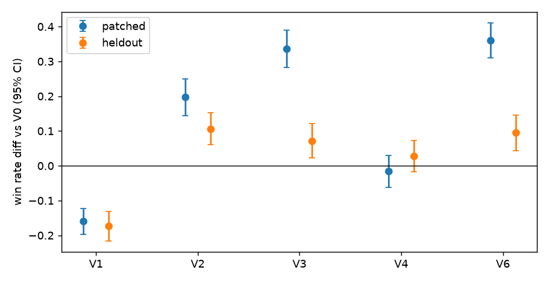
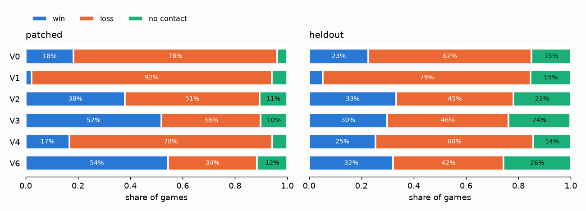
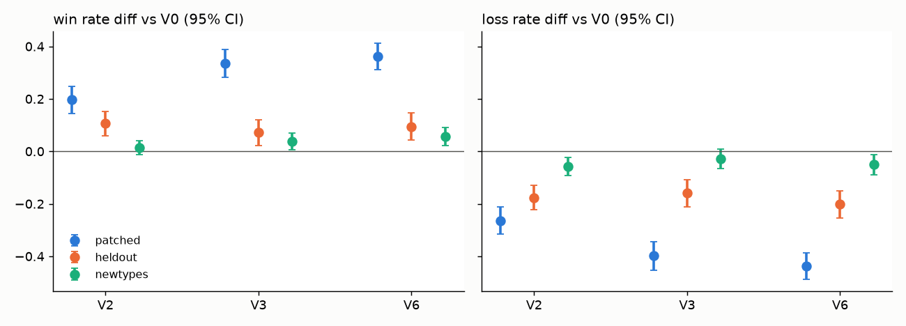

# BT 파라미터 실험 정리 (논문 공동 작성용)

> 2026-11-06 기준. 이 분야를 전공하지 않아도 처음부터 읽으면 실험 흐름을 따라갈 수 있게 썼다.
> 전문 용어는 처음 나올 때 풀어 쓰고, 끝의 [용어집](#7-용어집)에 모았다. 원자료와 자세한 표의 위치는 [6장](#6-자세한-자료-위치)에 있다.

## 1. 한눈에 보기

**연구 질문:** 공중전 AI의 행동 규칙 구조는 그대로 두고 **숫자 설정값만** 바꾸면 전투 결과가 얼마나 달라지는가? 그렇게 찾은 좋은 값은 처음 보는 상대에게도 통하는가?

**지금까지의 답을 세 줄로 줄이면:**

1. 숫자 설정값은 결과에 실제로 영향을 준다. 다만 "어떤 상대를 만났는가"의 영향이 더 크다.
2. 10개 값 중 중요한 것은 3개였다. 이 값으로 튜닝한 AI는 **값을 찾을 때 쓴 상대**에게 승률이 크게 올랐다 (약 18% → 54%).
3. 그러나 **상대가 새로울수록 이득이 줄었다** (대리모델 1위 V6 의 승률 이득 +36%p → +10%p → +6%p). 마지막 값은 상대 한 종의 영향이 커서 조심해서 해석해야 한다.

**실험 흐름 지도**

| 단계 | 날짜 | 묻는 것 | 경기 수 | 한 줄 결과 |
|---|---|---|---|---|
| ① 측정 도구 점검 | 11/2 | 잣대가 믿을 만한가? | 소규모 | 첫 검증은 실패, 재설계 뒤 통과 |
| ② 예비 실험 | 11/2 | 본실험을 할 가치가 있는가? | 2,400 | 신호는 있지만 상대가 스스로 추락하는 문제 발견 |
| ③ 상대 보정, 재예비 실험 | 11/2 | 문제를 고치면 어떻게 되는가? | 2,400 | 추락 문제 해결, 1차 지표를 Δwez 로 변경 |
| ④ 계획 고정 | 11/2 | 결과를 보기 전에 규칙 고정 | — | 태그 `prereg-bt-v1` |
| ⑤ 본실험 (RQ1, RQ2) | 11/2–11/5 | 무엇이 얼마나 중요한가? | 12,288 + 3,072 | 중요 파라미터 3개 |
| ⑥ 확인 단계 (RQ3) | 11/5 | 찾은 좋은 값이 새 시드에서도 좋은가? | 1,728 | 후보 3개 모두 기준보다 나음 |
| ⑦ 튜닝 BT 비교 | 11/5–11/6 | 처음 보는 상대에게도 통하는가? 교범값과 비교하면? | 5,184 | 이득이 크게 줄어듦, 교범값 변형은 더 나쁨 |
| ⑧ 사후 탐색 | 11/6 | 승패 뒤에 무슨 일이 있었나? | 재생 60 | 패배 감소의 절반가량이 승리가 아닌 무접촉으로 |
| ⑨ 새 상대 재검증 | 11/6 | 또 다른 새 상대에게는? | 2,592 | 이득이 더 작고 상대 의존적 |

④–⑥ 은 처음 세운 본 계획이고, ⑦–⑨ 는 결과를 본 뒤 **추가한** 실험이다. 이 구분은 논문에서 중요하다 ([5장](#5-논문에-쓸-때-지켜야-할-것)).

주요 단계에서 치른 경기는 합계 **29,664경기**다 (②③⑤⑥⑦⑨, 소규모 점검 제외).

## 2. 먼저 알아야 할 것

### 2.1 시뮬레이션과 경기 규칙

전투기 두 대가 1대1로 근접 공중전 (도그파이트) 을 벌이는 시뮬레이션이다. JSBSim 이라는 비행 물리 엔진을 쓰며, **엔진은 한 번도 고치지 않았다.**

- **청 (blue):** 우리가 연구하는 AI.
- **적 (red), 상대:** 싸우는 상대 AI.
- **HP:** 체력. 100에서 시작해 상대의 사격 범위에 들어가 있는 동안 줄어든다.
- **WEZ (Weapon Engagement Zone, 사격 가능 구역):** 거리 500–3,000 ft 이고 기수가 상대를 30° 안으로 향할 때 피해를 줄 수 있는 구역.
- **ATA (Antenna Train Angle):** 내 기수 방향과 상대 방향 사이의 각도. 작을수록 정확히 겨눈 것이다.

**경기가 끝나는 방식**

| 종료 | 뜻 | 결과 |
|---|---|---|
| 격추 | 한쪽 HP 가 0 | 살아남은 쪽 승 |
| 하드덱 (hard deck) | 고도 1,000 ft 아래로 내려감 (지면 충돌에 해당하는 선) | 내려간 쪽 패 |
| 실속 | 100 kt 미만을 누적 10초 (너무 느려 비행 불가) | 실속한 쪽 패 |
| 판정 | 300초 종료, 피해 교환 있음 | 체력 많은 쪽 승 |
| 무접촉 | 300초 동안 양쪽 모두 피해 없음 | 기록은 무승부. **엔진의 리그 규칙으로는 양쪽 모두 패 (0점)** |

### 2.2 행동 트리 (BT) 와 파라미터 θ

**행동 트리 (Behavior Tree, BT)** 는 AI의 행동을 "위에서부터 조건을 확인해 처음 맞는 행동을 한다"는 규칙 목록으로 적은 것이다. 연구 대상 트리 `energy_fighter.yaml` 의 우선순위를 단순하게 쓰면 이렇다.

1. 너무 낮으면 고도 회복 (`recover_altitude`)
2. 적이 위협적이고 가까우면 방어 기동 (`break_defense`)
3. 사격 범위면 조준 사격 (`gun_track`)
4. 너무 느리면 속도 회복 (`energy_recover`)
5. 에너지가 앞서고 뒤를 잡았으면 공세 (`press_offense`)
6. 각도·거리 싸움을 위한 요요 기동 (`yoyo_*`, 올라갔다 내려오며 위치를 잡는 기동)
7. 그 밖에는 기본 추격 (`pure_default`)

"너무 낮으면", "너무 느리면"의 **기준 숫자**가 파라미터이고, 10개 값의 묶음 하나를 **θ (세타)** 라고 부른다. 트리 구조는 고정하고 θ 만 바꾼다. 기본 설정값은 **기준 θ (V0)** 다.

| 파라미터 | 뜻 (쉽게) | 기준값 | 범위 |
|---|---|---|---|
| **fight_kcas** | 이 속도 (kt) 아래면 속도 회복 시작 | 280 | 220–330 |
| **threat_aspect_deg** | 적의 기수가 나를 향한 정도를 나타내는 각도 (aspect) 가 이 값을 넘으면 위협으로 판단 (값이 낮을수록 더 자주 위협으로 본다) | 150 | 120–170 |
| **floor_ft** | 이 고도 (ft) 아래면 고도 회복 시작 | 4500 | 3000–7000 |
| merge_range_ft | 방어 기동을 고려하는 근접 거리 | 6000 | 4000–9000 |
| gun_range_ft | 조준 사격 노드가 켜지는 거리 | 3000 | 1500–3000 |
| gun_ata_deg | 조준 사격 노드가 켜지는 각도 | 45 | 15–60 |
| energy_min_ft | 공세 전환에 필요한 에너지 우위 | 500 | 0–2000 |
| lead_time_s | 공세 때 상대의 앞을 얼마나 내다보고 겨눌지 | 2.0 | 0.5–3.0 |
| break_g_burst | 방어 기동을 얼마나 세게 당길지 | 0.5 | 0–1 |
| closing_min_fps | 요요 기동을 되당기는 접근 속도 기준 | 60 | 0–200 |

굵은 3개가 나중에 중요하다고 밝혀진 값이다. 비교 기준으로 쓰려고 **아무 효과도 없는 가짜 파라미터 dummy** 도 함께 넣었다.

### 2.3 실험 설계에 쓴 말

- **기하 (geometry):** 시작 위치 관계. 유리한 위치 `perch_offense`, 불리한 위치 `perch_defense`, 대등한 `neutral` 3종.
- **시드 (seed):** 시작 조건의 작은 차이를 정하는 숫자. 같은 θ·상대·기하·시드면 결과가 완전히 같다 (이 엔진은 결정적이다). 그래서 PC 가 달라도 재현을 확인할 수 있었다.
- **셀 (cell):** 기하·상대·시드의 조합 하나. 본실험은 θ 하나당 3 × 4 × 4 = **48경기** 를 치렀다.
- **짝 비교:** 두 θ 를 같은 셀끼리 비교하는 방법. 시작 조건의 차이가 지워져 적은 경기로도 차이를 잘 잡는다.

### 2.4 결과를 읽을 때 쓰는 통계

- **%p (퍼센트포인트):** 비율끼리의 차이. 승률 20% → 26% 는 +6%p 다.
- **95% CI (신뢰구간):** 추정값의 불확실성 범위. 차이의 CI 가 0을 포함하면 "차이가 있다"고 말하기 어렵다.
- **p 값:** 실제로 차이가 없을 때 이만큼의 차이가 우연히 나올 확률. 보통 0.05 미만이면 "유의하다"고 한다.
- **Holm 보정:** 비교를 여러 번 하면 우연히 유의한 결과가 나오기 쉬워지므로 p 값을 보수적으로 고치는 방법.
- **유의하지 않음 ≠ 같음:** 차이를 못 찾았다고 같다는 뜻은 아니다. "같다"고 말하려면 **동등성 검정 (TOST)** 을 통과해야 한다. 미리 정한 범위 안에 차이가 있음을 확인하는 검정이다.

## 3. 본 계획의 흐름 (①–⑥)

### ① 측정 도구 점검: 잣대부터 믿을 수 있는가

**왜:** 실험 전에 "나쁜 설정은 나쁘게, 사소한 변경은 비슷하게" 측정되는지 확인해야 한다. 잣대가 틀리면 뒤의 모든 결과가 무의미하다.

**첫 시도는 실패했다.** 직관적으로 나쁠 것 같은 θ 두 개를 골랐는데, 그중 A (고도 회복을 늦추고 방어 기동을 약하게) 는 오히려 승률이 37.5% → 62.5% 로 올랐다. 잣대의 문제가 아니라 **"나쁜 값"을 직관으로 고른 설계 문제**로 판단했다. 이 값이 왜 좋았는지는 ②에서 드러난다.

**R0 검증으로 재설계:** 작동 원리상 확실히 나쁠 수밖에 없는 극단값을 넣었다. 예를 들어 `fight_kcas=1000` 은 기체가 낼 수 없는 속도라서 늘 속도 회복만 하게 된다.

| 시험 | 내용 | 의도한 행동이 늘었는가 | 결과가 나빠졌는가 |
|---|---|---|---|
| R0-1 | `floor_ft=40000` (늘 고도 회복) | 예 | 아니오. 상대가 실속해서 이긴 경기가 많았다 |
| R0-2 | `fight_kcas=1000` (늘 속도 회복) | 예 | **예** |
| R0-3 | 항상 위협으로 판단 (늘 방어) | 예 | 뚜렷하지 않음 |

**판단:** 모두 통과해야 한다는 처음 규칙으로는 불통과였다. 결과를 본 뒤 규칙을 "악화가 확인된 설정이 하나 이상 있고 (민감도), 사소한 변경은 잡음 안에 있으면 (특이도) 통과"로 바꿨다. **결과를 본 뒤 바꾼 규칙이므로 논문에 그대로 밝혀야 한다.**

### ② 예비 실험: 본실험을 할 가치가 있는가

**왜:** 본실험 전에 θ 를 바꾸는 것이 실제로 결과 차이를 만드는지 확인했다. 판단 규칙은 실행 전에 커밋했다.

**무엇을:** 무작위로 고른 θ 50개 × 48경기 = 2,400경기.

**결과:** θ 에 따른 차이 (신호) 가 잡음보다 충분히 커서 통과했다. 그런데 이상한 점이 나왔다. **청 승리의 69% 가 상대의 하드덱 추락**이었다. 하드덱 종료 568경기 중 550경기에서 상대가 떨어졌다.

**진단:** 20경기를 다시 재생해 보니 모두 같은 패턴이었다.

- 상대 AI는 1,200 ft 에서야 고도 회복을 시작하는데, 하드덱은 1,000 ft 다.
- 회복을 시작한 뒤 0.25–0.9초 만에 추락했다.
- 최대 9 G 로 즉시 당긴다고 가정해도 20경기 중 15경기는 회복이 불가능했다.

즉 이 값들은 AI 실력이 아니라 **상대의 안전장치가 이 엔진 물리에 맞지 않아 생긴 허점**을 재고 있었다. ①에서 θ A 가 거둔 30승 중 29승도 상대의 하드덱 추락이었다.

### ③ 상대 보정과 재예비 실험, 그리고 1차 지표 변경

**상대 보정:** 원칙은 "상대에게 청과 같은 고도 안전장치를 준다"는 것이다. 상대 원본 파일은 그대로 두고, 복사본에서 고도 회복 노드 한 곳만 바꿨다 (`floor_ft` 1200 → 4500, 회복 강도 0.8). 규칙과 합격 기준은 실행 전에 커밋했다.

| | 원본 상대 | 보정 상대 |
|---|---|---|
| 상대 하드덱 비율 | 26.4% | **0%** |
| 상대가 고도 회복에 쓴 시간 | 0.3% | 12.5% (기준 20% 이하) |

**재예비 실험 (2,400경기):** 같은 규칙으로 통과했다. 기준 θ 승률은 약 37.5% 에서 약 21% 로 떨어졌다. 허점이 사라졌으니 자연스러운 결과다.

**1차 지표 변경:** **1차 지표**란 판정에 쓰기로 미리 정한 대표 잣대다. 승률로 하려 했으나, 기준 승률이 21% 로 낮아 확실히 나쁜 R0-2 조차 승률로는 유의한 악화가 잡히지 않았다 (바닥 효과: 값이 이미 낮으면 더 떨어질 여지가 없는 현상). 그래서 민감도를 통과한 **Δwez** 로 바꿨다.

> **Δwez = wez_blue − wez_red [초]:** 내가 상대를 사격 구역에 둔 시간에서 상대가 나를 사격 구역에 둔 시간을 뺀 값. 양수면 내가 더 많이 겨눈 것이다.

**이것도 결과를 본 뒤의 결정**이며 계획서에 기록돼 있다.

### ④ 계획 고정 (사전 등록)

**사전 등록 (preregistration):** 결과를 보기 전에 가설, 지표, 분석 방법을 문서로 고정하는 것이다. 결과를 본 뒤 유리한 분석만 고르는 일을 막는다.

- 계획서 `PREREG_BT.md` 를 git 태그 `prereg-bt-v1` 로 고정했다 (2026-11-02 23:54 KST). 태그가 없으면 실행 코드가 본실험을 거부하도록 잠갔다.
- 이후의 변경은 계획서를 고치지 않고 `PREREG_BT_DEVIATIONS.md` 에 덧붙이기만 한다 (현재 7건).

**연구 질문 (RQ)**

- **RQ1:** 결과의 차이 중 θ 몫은 얼마인가?
- **RQ2:** 10개 중 어떤 파라미터가 중요한가? 기하에 따라 다른가?
- **RQ3 (조건부):** 찾아낸 좋은 θ 가 새 시드에서도 기준보다 나은가?

### ⑤ 본실험: RQ1·RQ2

PC 3대가 나눠서 돌렸다 (PC1 연우, PC2 주엽, PC3 주혁). 결과를 합치기 전에 중복, 누락, 코드·엔진 버전을 자동 검사했다. 시간 초과 경기 33개 (PC2) 는 계획의 규칙대로 지우고 다시 돌렸다. 분석 코드는 결과를 보기 전에 커밋했다.

#### RQ1. 결과 차이의 원인을 나누면

**방법:** 분산분해 (ANOVA η²). 결과가 들쭉날쭉한 정도 전체를 100으로 놓고 각 원인의 몫을 계산한다. θ 64개를 고르게 뽑았다 (라틴 하이퍼큐브: 범위를 빠짐없이 덮도록 뽑는 표본 추출). 3,072경기.

| 원인 | 몫 |
|---|---|
| 상대 | 30.0% |
| **θ** | **12.1%** |
| θ×상대 (상대에 따라 좋은 θ 가 달라지는 정도) | 10.6% |
| 기하 관련 항들 합계 | 4.0% |
| 잔차 (시드 + 나눌 수 없는 복합 효과) | 43.3% |

**읽는 법:** θ 는 분명히 영향을 주지만, 상대가 누구인지가 더 크다. "상대에 따라 좋은 θ 가 다르다"는 몫도 θ 몫만큼 크다. 이 결과는 ⑦–⑨ 를 미리 말해 주는 단서였다.

#### RQ2. 어떤 파라미터가 중요한가

**방법:** Morris 민감도 분석. 파라미터를 한 번에 하나씩 바꾸며 결과 변화를 재는 일을 여러 경로로 반복한다. θ 192개, 9,216경기.

- **μ\*:** 바꿨을 때 결과가 평균적으로 얼마나 크게 변하는가 (방향 무시).
- **μ:** 변화의 방향까지 본 평균. 음수면 값이 커질수록 Δwez 가 나빠진다.

| 파라미터 | μ\* | μ | 판정 | 뜻 |
|---|---|---|---|---|
| fight_kcas | 2.73 | −2.73 | **중요** | 낮을수록 좋다 (속도 회복을 덜 한다) |
| threat_aspect_deg | 1.41 | +1.29 | **중요** | 높을수록 좋다 (방어 기동을 덜 한다) |
| floor_ft | 1.26 | −1.25 | **중요** | 낮을수록 좋다 (고도 회복을 늦게 한다) |
| break_g_burst | 0.62 | +0.56 | 기준 미달 | |
| 나머지 6개 | 0.23–0.40 | | 중요 아님 | |
| dummy | 0 | 0 | | 예상대로 정확히 0 |

세 값 모두 **방어·회복 행동을 덜 하는 방향**이 유리했다. 기하별로는 floor_ft 만 차이가 뚜렷했다 (neutral 에서만 중요).

**규칙 변경 1건:** dummy 를 잡음 기준으로 쓰려 했는데, 트리에 들어가지 않아 효과가 정확히 0 이라 기준 역할을 못 했다. 그래서 "부호를 무작위로 뒤집어 만든 잡음 분포"를 기준으로 바꿨다. θ 별 결과를 보기 전에 결정했고, 김주혁이 문제를 발견했다 (DEVIATIONS #3).

#### 대리모델과 견고성 점검

- **대리모델 (surrogate):** 경기를 돌리지 않고 θ 로 결과를 예측하는 기계학습 모형. 학습에 안 쓴 θ 에서 R² 0.910 이었다 (1에 가까울수록 예측이 정확. 계획의 기준은 0.5 이상).
- **원본 상대 견고성:** 같은 θ 를 보정 전 상대와도 붙였다 (3,072경기). θ 별 평균 Δwez 의 두 환경 상관은 0.93 으로 높았다. 다만 이는 **같은 상대의 보정 전후 비교**이지, 새 상대에 대한 일반화는 아니다.

### ⑥ 확인 단계: RQ3

**왜 새 시드인가:** 여러 θ 중 1등을 고르면 실력 외에 운도 함께 뽑힌다 (승자의 저주). 그래서 후보는 새 시드로만 평가한다. 후보 선택 규칙은 후보를 뽑기 전에 커밋했다.

**무엇을:** 기준 θ + 후보 3개 × 432경기 = 1,728경기. Δwez 는 짝 비교로 판정했다.

| θ | 역할 | Δwez 평균 [s] | 기준 대비 차 [s] (95% CI) | 승률 |
|---|---|---|---|---|
| f2306532ecff | 기준 | −2.80 | — | 13.4% |
| 406275eeea4e | 관측 1위 | −0.29 | **+2.50** (+2.20, +2.81) | 54.9% |
| c1e4a1d09296 | 대리모델 1위 | −0.01 | **+2.78** (+2.48, +3.09) | 57.6% |
| d926b86fb45f | 대리모델 2위 | −0.20 | **+2.60** (+2.30, +2.90) | 53.9% |

**읽는 법:**

- 셋 다 미리 정한 "실질적으로 낫다" 기준 (+0.5 s 이상) 을 통과했다.
- 승자의 저주가 실제로 보였다. 관측 1위의 Δwez 는 본실험 +0.285 s 에서 새 시드 −0.29 s 로 떨어졌다.
- 하지만 **상대는 그대로**다. 새 시드에서 좋다는 것이지, 새 상대에게 좋다는 뜻은 아니다. 그래서 ⑦ 로 넘어갔다.

**본 계획은 여기까지다.**

## 4. 결과를 본 뒤 추가한 실험 (⑦–⑨)

세 실험 모두 실행 전에 별도 계획서와 분석 코드를 태그로 고정했다. 그래도 **앞선 결과를 본 뒤 설계한 사후 추가 실험**이므로 확증 증거가 아니라 일반화 점검으로 해석한다.

### ⑦ 튜닝 BT 비교: 처음 보는 상대에게도 통하는가

**왜:** ⑥의 좋은 θ 가 낯선 상대에게도 통하는지, 교범값과 비교하면 어떤지 묻는다. 지표는 이해하기 쉬운 **승률**로 정했다.

**상대 묶음**

- **patched:** 본실험 상대 4종 (A2, B2, C1, D1). 튜닝에 쓴 상대다.
- **heldout:** 본실험에 안 쓴 4종 (A1, A3, B1, red_prime). 처음 보는 상대다.

**변형 6개**

| 변형 | 내용 |
|---|---|
| V0 | 기준값 |
| V1 | 교범값: fight_kcas 325, threat_aspect_deg 120 |
| V2 | fight_kcas 만 유리한 쪽으로 (231) |
| V3 | 중요 3개를 유리한 쪽으로 (fight 231, threat 165, floor 3400) |
| V4 | 중요하지 않다고 나온 7개만 무작위로 변경 |
| V6 | ⑥의 대리모델 1위 θ |

V5 는 V3 와 같은 값이 되어 **결과를 보기 전에 뺐다.** 이름은 초안과 맞추려고 V6 을 유지했다.

**결과 (V0 대비 승률 차, 짝 432쌍)**

| 변형 | patched | heldout | 사전 예상 |
|---|---|---|---|
| V1 교범값 | **−16.0%p** | **−17.4%p** | 낮음, 맞음 |
| V2 | **+19.7%p** | **+10.6%p** | 높음, 맞음 |
| V3 | **+33.6%p** | **+7.2%p** | 높음, 맞음 |
| V4 | −1.6%p | +2.8%p | 비슷함, **동등성 미확인** |
| V6 | **+36.1%p** | **+9.5%p** | 높음, 맞음 |

굵은 값은 Holm 보정 후 유의하다.

**읽는 법:**

- **튜닝 효과는 있지만 처음 보는 상대에게는 크게 줄었다.** V3·V6 은 약 1/4, V2 는 약 절반으로 줄었다. RQ1의 θ×상대 몫과 맞는 결과다.
- **V4:** 차이는 유의하지 않지만 ±5%p 동등성은 통과하지 못했다. "나머지 7개는 승률과 무관하다"고 쓰면 안 된다.
- **V1 을 "교범이 틀렸다"로 읽으면 안 된다.** 교범 수치를 BT 문턱값으로 옮긴 **한 가지 방식**의 결과일 뿐이다.
  - fight_kcas: 교범은 전투 중 **유지할 목표 속도**이고, BT 는 **속도 회복으로 바꾸는 문턱값**이다. 개념이 다르다.
  - threat_aspect_deg: 머지 진입 판정 각도를 위협 판정으로 옮긴 것으로, 대응이 약하다.
  - 두 값을 함께 바꿨으므로 어느 쪽이 원인인지도 모른다. V1 은 방어 기동 시간이 8% → 30% 로 크게 늘었다.
  - 교범 수치는 엔진 `doctrine.py` 의 절 번호 표기를 따랐고, **원 교범과의 대조는 아직 하지 않았다.**
- **바닥 상대:** C1 과 red_prime 은 어떤 변형도 거의 이기지 못했다 (최대 6.5%).

### ⑧ 사후 탐색: 승패 뒤에 무슨 일이 있었나

**왜:** A3 상대에서 V6 의 승률이 오히려 떨어진 이유를 찾다가, 승률만으로는 보이지 않는 변화를 발견했다. **새 경기 없이 ⑦ 의 데이터를 다시 나눈 서술용 분석이며, 판정을 바꾸지 않는다.**

| V0 대비 변화 (%p) | 승 | 패 | 무접촉 |
|---|---|---|---|
| V6, patched | +36 | −44 | +8 |
| V6, heldout | +10 | −20 | +11 |

**읽는 법:**

- patched 에서는 줄어든 패배가 대부분 승리로 갔다. heldout 에서는 **절반가량이 무접촉으로** 갔다. 덜 지지만 끝내지는 못했다는 뜻이다.
- A3 상대가 극단적인 예다. V0 → V6 에서 패배는 33% → 3% 로 줄었지만, 승리도 51% → 37% 로 줄고 무접촉이 60% 가 됐다.
- 엔진 리그 규칙은 무접촉을 양쪽 패로 치므로, 승률을 보는 것이 규칙과 맞다. 그래도 **승률은 득점을, 패배율은 생존을** 보여 주므로 나눠 봐야 한다.
- 표본 60경기를 재생해 보니 (CSV 와 모두 일치), V6 의 무접촉 경기는 도망이 아니었다. 시간의 86–99% 를 6,000 ft 안에서 보냈지만 사격 구역에는 한 번도 들지 못했다. **가까이서 돌지만 기수를 맞추지 못하는 교착**으로 보인다. 원인은 아직 모른다 (표본이 작고 선택 편향이 있다).

### ⑨ 새 상대 재검증: 또 다른 새 상대에게는

**왜:** heldout 결과는 이미 봤으므로 더는 "처음 보는 상대"가 아니다. 그래서 아직 안 쓴 유형의 상대로 다시 묻는다. **θ 값은 새로 고르지 않았다.**

**무엇을:** V0, V2, V3, V6 × `newtypes` 상대 6종 (C2, C3, D2, E1, red_energy, red_tracker) × 3기하 × 36시드 = 2,592경기. ⑧ 을 반영해 1차 지표를 **승률과 패배율 2개**로 정했다. 패배율은 적이 이긴 비율이며 무접촉은 넣지 않는다.

**미리 고정한 판정 문장:** "일반화됨" (승률이 유의하게 상승), "악화", "생존만 일반화됨" (승률은 유의하지 않고 패배율만 유의하게 감소), "일반화 안 됨".

**결과 (V0 대비, 648쌍)**

| 변형 | 승률 차 (95% CI) | 패배율 차 (95% CI) | 판정 |
|---|---|---|---|
| V2 | +1.4%p (−1.4, +4.1) | **−5.7%p** (−9.1, −2.3) | 생존만 일반화됨 |
| V3 | +3.7%p (+0.5, +6.9), Holm p 0.059 | −2.9%p (−6.7, +0.8) | 일반화 안 됨 |
| V6 | **+5.7%p** (+2.3, +9.1) | **−5.1%p** (−8.8, −1.4) | 일반화됨 |

**세 묶음을 나란히 보면 (시드와 상대가 달라 보기만 한다)**

| V6, V0 대비 | patched | heldout | newtypes |
|---|---|---|---|
| 승률 차 | +36.1%p | +9.5%p | +5.7%p |
| 패배율 차 | −43.8%p | −20.1%p | −5.1%p |

**"일반화됨" 이라는 판정을 그대로 믿으면 안 되는 이유**

- **red_energy 의존:** 이 상대를 빼고 다시 계산하면 V6 의 승률 차는 +2.8%p (−0.6, +6.1), 패배율 차는 −0.4%p (−4.2, +3.5) 로 둘 다 CI 가 0을 포함한다. V2·V3 도 마찬가지다. red_energy 는 청 트리와 노드 이름·구조가 닮은 상대다. **이 계산은 결과를 본 뒤 따로 한 것으로, 보고서에는 아직 없다.**
- **통계의 범위:** 위 CI 는 "이 6종 상대에 대해서"의 불확실성이다. 상대 6종의 평균으로 다시 계산하면 V6 승률 차의 CI 는 (−5.3, +16.7) 로 훨씬 넓다.
- **상대별 차이:** V6 승률은 red_energy +20%p, C3 +13%p, D2 −9%p 로 방향이 갈린다.
- **바닥 상대:** 6종 중 4종이 V0 승률 5% 미만이다. 이들을 빼면 2종만 남아 해석 범위가 좁다.

**바뀐 추측:** ⑦ 에서는 V2 만으로도 V3·V6 과 비슷해 "일반화되는 효과는 주로 fight_kcas 에서 나온다"고 추측했다. ⑨ 에서는 V6 이 V2 보다 승률이 높아 (+4.3%p, CI +1.2, +7.4, 서술용) 이 추측이 약해졌다.

**논문에 쓸 만한 문장:** "새 상대 묶음에서 튜닝 이득은 작게 유지됐고 상대에 따라 크게 달랐으며, 특히 유사한 상대 하나의 영향이 컸다."

## 5. 논문에 쓸 때 지켜야 할 것

### 5.1 어떤 결과가 어떤 지위인가

| 결과 | 지위 | 쓰는 법 |
|---|---|---|
| RQ1, RQ2, RQ3 | 사전 등록된 본 계획 | 주 결과. 단 1차 지표와 상대 보정은 등록 전, 결과를 본 뒤의 결정임을 밝힌다 |
| 원본 상대 견고성 | 등록 뒤 사양을 보충 (DEVIATIONS #2) | 서술용 |
| ⑦ 튜닝 BT 비교, ⑨ 새 상대 재검증 | 별도 사전 계획이 있는 **사후 추가 실험** | 본실험과 구별해 일반화 점검으로 |
| ⑧ 승·패·무접촉, 재생 분석 | **사후 탐색** | 가설 제시용. 확인된 사실로 쓰지 않는다 |
| red_energy 제외 계산 | **사후 탐색, 아직 파일로 기록 안 됨** | 기록한 뒤 인용한다 |

### 5.2 처음 규칙에서 바꾼 것 (논문에 밝힐 것)

1. R0 판정 규칙 변경 (①)
2. 상대 보정 (②→③, 규칙과 합격 기준은 실행 전 커밋)
3. 1차 지표 승률 → Δwez (③)
4. RQ2 중요 판정 기준 변경 (⑤, θ 별 결과를 보기 전)
5. RQ3 후보 선택 규칙 보충 (⑥, 본실험 분석을 본 뒤, 확인 단계 실행 전)
6. ⑨ 의 1차 지표에 패배율 추가 (⑧ 을 본 뒤)

### 5.3 쓰면 안 되는 문장

| 쓰면 안 됨 | 이유 | 대신 |
|---|---|---|
| "교범값이 틀렸다", "튜닝이 교범보다 낫다" | 교범 수치를 옮긴 한 가지 방식일 뿐, 대응이 약한 값도 있다 | "이 대응 방식의 V1 은 V0 보다 승률이 낮았다" |
| "나머지 7개 파라미터는 승률과 무관하다" | V4 동등성 미통과 | "중요 3개에 비해 Δwez 효과가 작았다" |
| "튜닝은 새 상대에게 일반화된다" | 이득이 작고 상대 의존적 | 4장 ⑨ 의 문장 |
| "V3 는 효과가 없다" | Holm p 0.059, 기준을 아슬아슬하게 넘음 | "미리 정한 기준을 충족하지 못했다" |
| "실제 전투기 조종에도 적용된다" | 아래 한계 참고 | 시뮬레이션 안의 결과로 한정 |

### 5.4 공통 한계

- **트리 하나:** 하나의 BT 구조에서 숫자 10개만 바꿨다. 다른 구조로 넓힐 수 없다.
- **보정 상대:** 상대의 고도 안전장치를 바꿨다. 원본 상대와 다르다.
- **상대 표본:** 합계 14종이고 무작위로 뽑은 것이 아니다. 저장소에 있는 상대를 썼다.
- **바닥 효과:** 일부 상대 (C1, red_prime, C2, red_tracker 등) 에게는 어떤 θ 도 거의 이기지 못한다.
- **판정승 비중:** 승리의 상당수는 격추가 아니라 시간 종료 판정승이다.
- **시뮬레이션 밖:** 다른 적기, 미사일, 연료, G 내성, 센서 한계와 모델 충실도 차이는 이 실험들로 확인할 수 없다.

### 5.5 아직 남은 일

| 일 | 상태 |
|---|---|
| 교범 수치를 원 교범과 대조 | **연구진 확인 필요** |
| red_energy 제외 계산을 파일로 기록 | 결정 대기 (권장) |
| V1 분해 실험 (fight 325 단독, threat 120 단독, 약 1,728경기) | 결정 대기 (권장) |
| 3개 파라미터 요인 실험 (약 4,320경기) | 건너뛰기를 권장 (이득이 작고 상대 의존적) |

## 6. 자세한 자료 위치

경로는 `cadet_research/` 기준이다. 결과 CSV 는 저장소에 올리지 않았다.

| 내용 | 파일 |
|---|---|
| 본 계획서, 이탈 기록 | `PREREG_BT.md`, `PREREG_BT_DEVIATIONS.md` |
| 추가 실험 계획서 | `PREREG_BT_ADDENDUM_TUNING.md`, `PREREG_BT_ADDENDUM_GENERALIZE.md` |
| ① 측정 도구 점검 | `kit/bt/out/validation.md` |
| ② 예비 실험, 하드덱 진단 | `kit/bt/out/pilot_report.md`, `kit/bt/out/diag_hard_deck.md` |
| ③ 상대 보정, 재예비 실험 | `kit/bt/analysis/opponent_patch_rules.md`, `kit/bt/out/opponent_patch_check.md`, `kit/bt/out/pilot2_report.md` |
| ⑤⑥ 본실험, 확인 단계 요약 | `kit/bt/out/analysis/main_report.md` (세부: `rq1_eta2.md`, `morris.md`, `morris_geometry.md`, `surrogate.md`, `robust_original_eta2.md`, `confirm.md`) |
| ⑦ 튜닝 BT 비교 | `kit/bt/out/analysis/tuning_report.md` |
| ⑧ 사후 탐색 | `kit/bt/out/analysis/stage0_report.md` |
| ⑨ 새 상대 재검증 | `kit/bt/out/analysis/generalize_report.md` |
| 상대 합격 점검 | `kit/bt/out/heldout_check.md`, `kit/bt/out/newtypes_check.md` |

**고정 태그:** `prereg-bt-v1` (본 계획), `prereg-bt-tuning-v1` (⑦), `prereg-bt-generalize-v1` (⑨).

## 7. 용어집

| 용어 | 설명 |
|---|---|
| %p | 비율끼리의 차이 (퍼센트포인트) |
| 95% CI | 추정값의 불확실성 범위. 차이의 CI 가 0을 포함하면 차이를 주장하기 어렵다 |
| ANOVA, η² | 결과의 변동을 원인별 몫으로 나누는 분석과 그 몫 |
| ATA | 내 기수 방향과 상대 방향 사이의 각도 |
| BT (행동 트리) | 조건을 위에서부터 확인해 행동을 정하는 규칙 구조 |
| Holm 보정 | 여러 번 비교할 때 p 값을 보수적으로 고치는 방법 |
| HP | 체력 (100에서 시작) |
| KCAS, kt | 속도 단위 (노트). KCAS 는 조종석 계기에 나타나는 속도 기준 |
| McNemar 검정 | 짝 비교에서 한쪽만 이긴 경우의 수를 비교하는 검정 |
| Morris 분석 | 파라미터를 하나씩 바꿔 중요도를 재는 민감도 분석 |
| R² | 예측이 얼마나 맞는지 나타내는 값 (1에 가까울수록 정확) |
| R0 | 일부러 극단적으로 나쁘게 만든 θ 로 잣대를 점검하는 검증 |
| RQ | 연구 질문 (Research Question) |
| TOST | 차이가 정해 둔 범위 안에 있음을 확인하는 동등성 검정 |
| WEZ | 사격 가능 구역 (거리 500–3,000 ft, ATA 30° 이내) |
| Δwez | 내가 겨눈 시간 − 상대가 겨눈 시간 [초] |
| θ (세타) | 파라미터 10개 값의 묶음. V0 는 기준 θ |
| 기하 | 시작 위치 관계 (유리, 불리, 대등) |
| 교범 (doctrine) | 공중전 기동의 표준 지침. 여기서는 엔진 `doctrine.py` 에 적힌 수치 |
| 대리모델 | 경기 없이 θ 로 결과를 예측하는 기계학습 모형 |
| 무접촉 | 300초 동안 양쪽 모두 피해가 없는 종료 |
| 바닥 효과 | 값이 이미 매우 낮아 차이가 드러나기 어려운 현상. 여기서는 V0 승률 5% 미만인 상대를 바닥 상대라 부른다 |
| 사전 등록 | 결과를 보기 전에 계획을 고정하는 것 |
| 사후 추가 실험 / 사후 탐색 | 결과를 본 뒤 설계한 실험 / 결과를 본 뒤 한 서술용 분석 |
| 시드 | 시작 조건의 작은 차이를 정하는 숫자 |
| 셀 | 기하·상대·시드의 조합 하나 |
| 승자의 저주 | 여러 후보 중 1등을 고르면 운도 함께 뽑혀 다음 성적이 떨어지는 현상 |
| 실속 | 너무 느려 비행을 유지하지 못하는 상태 |
| 짝 비교 | 같은 조건끼리 두 θ 를 비교하는 방법 |
| 청 / 적 | 연구 대상 AI / 상대 AI |
| 하드덱 | 내려가면 패배하는 고도 하한 (1,000 ft) |
| 1차 지표 | 판정에 쓰기로 미리 정한 대표 잣대 |
