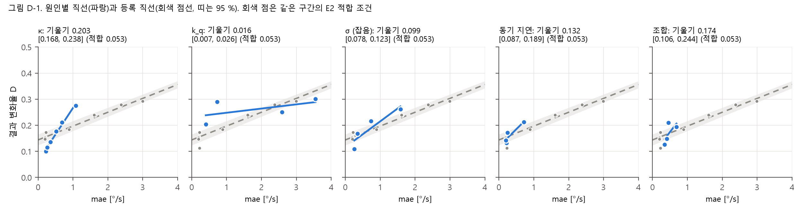
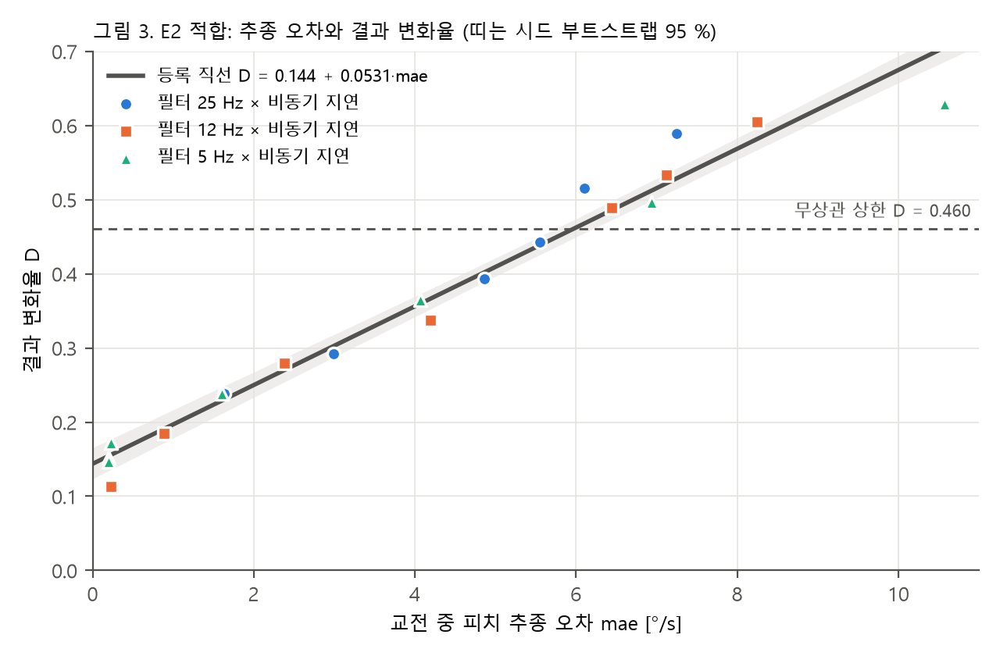
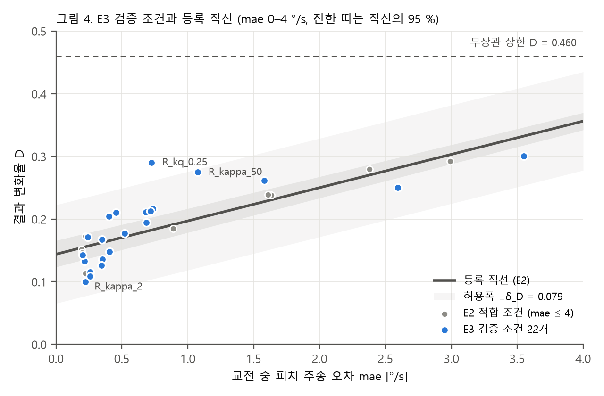

# cadet_research 검토 의견 처리 기록 — v2

> **정정 (2026-10-20, 패널 검토 P0)**: 이 문서 §5(D-4)의 무상관 상한 **0.403(E4 0.350, E1 0.386)은 plug-in 계산의
> 편향**이었다. 한 경기가 자기 자신과 일치하는 경우가 섞였다. 바로잡은 값은 **0.460(E4 0.467, E1 0.441)**이고,
> 상한 위 적합 조건은 8/20이 아니라 7/20이다. 또 상한 위를 "무정보"라 쓴 것은 틀렸다(분포 이동을 담는다).
> 본문은 기록으로 그대로 둔다. 바로잡은 표와 그림은 `kit/out/reanalysis_v2/`(다시 생성됨)와 `kit/out/reanalysis_p0/report_p0.md`에 있다.

작성 2026-10-19. 대상: v1 검토자와 연구 책임자. 작성: 코딩 담당.
처리 대상: `FEEDBACK_FOR_CADET_v1.md`(커밋 `8991432` 검토)의 필수 재분석 D-1~D-5.

**버전 규칙**: v1은 그대로 둔다. 이 문서는 v1 요청의 처리 결과와 v1에 대한 이견·보완이다.
다음 검토나 다음 처리(D-6 이후, 추가 실험, 문서 수정)는 `_v3`으로 새로 만든다.

**재현 방법**: `cd kit && python reanalysis_v2.py` (약 2분). 경기를 새로 돌리지 않고
`kit/out/{main,gen,feas3,cal}/games.csv`만 읽는다. 등록 파일(`tolerance.json`, `curve.json`)은 읽기만 한다.
전체 표는 `kit/out/reanalysis_v2/report_reanalysis_v2.md`, 수치는 `results.json`, 그림 3장은 같은 폴더에 있다.
모두 결과를 본 뒤 한 분석이므로 **등록된 판정을 바꾸지 않고 사실 보고로만 쓴다.**

---

## 0. 한 쪽 요약

| v1 항목 | 처리 | 결과 |
|---|---|---|
| 수치 재현 | 완료 | v1의 수치를 독립 재계산으로 모두 재현했다 (§1) |
| D-1 원인별 기울기 (§2.1) | 완료 | **v1에 동의.** 5개 묶음 모두 기울기 차이의 95 % CI가 0을 배제한다. **추가로**, 원인별 직선은 LOO 예측이 가장 나쁘다(0.071 대 공통 직선 0.038) |
| D-2 구간 맞춤 비교 | 완료 | κ 3.62배, k_q 0.31배, σ 1.44배(모두 CI가 0 배제). 동기 지연·조합은 같은 구간에 적합 조건이 없어 비교 불가 |
| D-3 차분 모형 (§2.4) | 완료 | **v1을 일부 수정.** E4의 +0.045 치우침은 절편 차이였다(열화끼리 쌍의 평균 오차 +0.000). **그러나 SHAM이 낀 쌍은 +0.188 틀린다.** ΔD 모형은 SHAM 모순을 풀지 못한다 |
| D-4 무상관 상한 (§2.5) | 완료 | 적합 8/20이 상한(0.403) 위, 검증 0/22. 그림 3·4에 상한을 그었다 |
| D-5 순환성 (§2.7) | 완료 | **v1을 수정.** 경기 수준 연결은 "없는" 것이 아니다(같은 경기 설정끼리 0.032/(°/s), 조건 간 기울기의 60 %). **결정적 답은 따로 나왔다**: mae와 D를 서로 다른 경기에서 재도 corr 0.969, 기울기 0.0543으로 그대로다 |
| v1에 없던 정보 | 기록 | 절전으로 잘린 28경기(판정 영향 없음), 롤 추종 탐색(예측 개선 없음), FLCS 문서 불일치 (§7) |

**한 줄 결론**: RQ1은 더 단단해졌고(순환성 반론을 정량적으로 막음), RQ2는 "조건부"로 내리는 것이 맞다.
D-3에서 **"열화끼리의 차이는 원인·참가자와 무관하게 맞힌다, 열화가 있느냐 없느냐의 점프는 못 맞힌다"**는
새 형태의 주장이 나왔다.

---

## 1. 재현 확인

v1과 같은 정의(`predict.py`의 `Table.pick`)로 다시 계산했다. v1과 다른 점은 부트스트랩 난수뿐이다.

| 수치 | v1 | 재계산 |
|---|---|---|
| 적합 기울기, 절편 | 0.0531, 0.1438 | 0.0531 [0.0499, 0.0560], 0.144 |
| κ 기울기 CI | [0.170, 0.238] | [0.168, 0.238] |
| k_q 기울기 CI | [0.007, 0.026] | [0.007, 0.026] |
| 풀링 세 모형 잔차 RMS | 0.0355 / 0.0349 / 0.0248 | 0.0355 / 0.0349 / 0.0248 |
| 조건 안 상관, 조건 간 상관 | 0.065, 0.971 | 0.065, 0.971 |
| 조건 안 사분위 뒤집힘률 | 0.232 / 0.256 / 0.301 / 0.293 | 0.232 / 0.256 / 0.301 / 0.292 |
| 기울기 재현 main / gen / feas3 | 0.0531 / 0.0547 / 0.0605 | 같음 (gen은 SHAM을 뺀 열화 5조건 기준이다. SHAM을 넣으면 0.0719) |
| 무상관 기준 E1 / E2 / E4 | 0.614 / 0.597 / 0.650 | 같음 |

---

## 2. D-1 원인별 기울기와 세 모형

| 묶음 | 조건 수 | mae 범위 [°/s] | 기울기 [95 % CI] | 적합 대비 | 기울기 차이 [95 % CI] | 절편 [95 % CI] |
|---|---|---|---|---|---|---|
| 필터·비동기 (적합) | 20 | 0.19–10.57 | 0.0531 [0.0499, 0.0560] | — | — | 0.144 [0.123, 0.166] |
| κ | 6 | 0.22–1.08 | 0.2029 [0.1684, 0.2379] | 3.82배 | +0.150 [0.118, 0.183] | 0.063 [0.027, 0.103] |
| k_q | 4 | 0.40–3.55 | 0.0161 [0.0068, 0.0262] | 0.30배 | −0.037 [−0.044, −0.029] | 0.232 [0.212, 0.256] |
| σ | 4 | 0.26–1.58 | 0.0988 [0.0777, 0.1233] | 1.86배 | +0.046 [0.027, 0.069] | 0.116 [0.088, 0.143] |
| 동기 지연 | 4 | 0.20–0.72 | 0.1323 [0.0873, 0.1886] | 2.49배 | +0.079 [0.035, 0.134] | 0.119 [0.095, 0.144] |
| 조합 | 4 | 0.35–0.69 | 0.1737 [0.1061, 0.2438] | 3.27배 | +0.121 [0.055, 0.190] | 0.087 [0.044, 0.127] |

기울기 차이는 같은 재표본에서 짝지어 냈다. **5/5 묶음이 0을 배제한다.**

| 42조건 풀링 모형 | 모수 | 잔차 RMS | **LOO RMS** | AIC |
|---|---|---|---|---|
| 공통 직선 | 2 | 0.0355 | **0.0382** | −276.4 |
| 원인별 절편 + 공통 기울기 | 7 | 0.0349 | 0.0442 | −267.7 |
| 원인별 직선 | 12 | 0.0248 | 0.0706 | −286.4 |

**v1에 대한 보완**: 잔차 RMS와 AIC는 원인별 직선을 고르지만, **조건 하나를 빼고 예측하는 LOO에서는
원인별 직선이 가장 나쁘다.** 원인 묶음마다 조건이 4–6개이고 mae 구간이 좁아서 기울기가 끝점 하나에 크게 흔들린다.
따라서 논문의 정확한 문장은 이렇다.

> 같은 추종 오차에서도 열화 원인에 따라 결과 변화의 기울기가 다르다(5개 묶음 모두, 0.30–3.82배).
> 그러나 원인별 직선으로 바꿔도 처음 보는 조건의 예측은 나아지지 않았다. 공통 직선은 원인과 관계없이
> 수준을 ±0.04 정도로 맞히는 조건부 지표이며, 원인 안의 용량-반응은 담지 못한다.

조건 사이의 독립성을 가정하는 F 검정은 하지 않았다. 42조건이 같은 시드 8개를 공유하기 때문이다.

---

## 3. D-2 겹치는 구간 비교

규칙은 실행 전에 정했다: 원인 묶음 mae 범위 ±0.05 °/s 안의 적합 조건만 쓴다. 적합 조건이 3개 미만이거나
mae 폭이 0.3 °/s 미만이면 비교 불가로 둔다.

| 원인 | 원인 기울기 | 같은 구간의 적합 조건 | 적합 기울기 | 비 | 차이 [95 % CI] |
|---|---|---|---|---|---|
| κ | 0.2029 | 5개 (0.19–0.89) | 0.0560 | 3.62배 | +0.147 [0.112, 0.183] |
| k_q | 0.0161 | 5개 (0.89–2.99) | 0.0511 | 0.31배 | −0.035 [−0.048, −0.020] |
| σ | 0.0988 | 4개 (0.22–1.61) | 0.0688 | 1.44배 | +0.030 [0.015, 0.045] |
| 동기 지연 | 0.1323 | 4개, mae 폭 0.03 | 비교 불가 | — | — |
| 조합 | 0.1737 | 없음 | 비교 불가 | — | — |

"모양 오지정 때문"이라는 반론은 κ, k_q, σ에서 막힌다. 다만 κ 구간의 적합 조건 5개 중 4개가 mae 0.19–0.22에
몰려 있어, 그 구간의 적합 기울기는 사실상 두 무리 사이의 기울기다. 동기 지연과 조합은 적합 집합에 그 구간의 점이
없어서 이 방법으로 답할 수 없다.

---

## 4. D-3 차분(ΔD) 모형

예측 ΔD = 0.0531·Δmae. 쌍은 mae가 작은 쪽에서 큰 쪽으로 놓았고, 오차가 양수면 실제 변화가 예측보다 크다.

| 쌍 묶음 | 쌍 | 평균 오차 [95 % CI] | 평균 \|오차\| | \|오차\| ≤ δ_D | 최대 \|오차\| |
|---|---|---|---|---|---|
| E3 원인 안 인접 수준 | 14 | +0.017 [0.011, 0.024] | 0.029 | 14/14 | 0.070 |
| E3 원인 안 모든 쌍 | 33 | +0.030 [0.023, 0.037] | 0.056 | 76 % | 0.139 |
| E3 원인 간 교차 쌍 | 120 | +0.020 [0.008, 0.033] | 0.049 | 82 % | 0.164 |
| **E4 열화끼리** (참가자 12종) | 10 | **+0.000 [−0.027, 0.026]** | 0.026 | 10/10 | 0.050 |
| **E4 SHAM ↔ 열화** | 5 | **+0.188 [0.166, 0.215]** | 0.188 | 0/5 | 0.214 |

참고로 절대 D 예측(등록 판정)의 E3 평균 |오차|는 0.034, E4 열화 5조건 평균 오차는 +0.045다.

**읽는 법**
1. **E4의 체계적 치우침(+0.045)은 절편 차이였다.** 참가자를 바꾸면 D의 바닥 높이는 달라지지만,
   열화끼리의 차이는 등록 기울기로 평균 오차 0으로 맞는다. 기울기 재현(main 0.0531 / gen 0.0547 / feas3 0.0605)과
   같은 이야기이고, **v1이 말한 "차분 형태가 가장 방어 가능하다"를 지지한다.**
2. **그러나 v1 §2.4의 "ΔD로 바꾸면 SHAM 모순도 사라진다"는 성립하지 않는다.** SHAM과 실제 열화 사이에는
   추종 오차가 거의 같은데도 D가 0.10–0.17 뛰는 점프가 있다(혼돈 바닥). ΔD 모형은 열화가 있는 조건끼리만 쓸 수 있다.
3. **원인 안의 기울기 차이는 ΔD에서도 그대로 남는다.** 원인 안 인접 쌍의 실제 ΔD는 예측의 평균 1.8배이고,
   작은 단계에서는 3–13배다(κ 2→4는 8.0배, σ 0.3→1은 12.1배). 14쌍이 모두 δ_D 안에 드는 것은 ΔD 자체가
   작아서(평균 0.041)다. **δ_D를 ΔD 판정에 그대로 쓰면 v1 §2.1의 "허용폭이 너무 넓다" 문제가 더 심해진다.**
4. 정확도는 나아지지 않았다. 쌍의 |오차|(0.049–0.056)는 두 조건의 오차가 합쳐지므로 절대 예측(0.034)보다 크다.

**논문용 문장(안)**

> 열화가 있는 두 조건 사이에서 결과 변화율의 차이는 추종 오차의 차이에 비례했다(기울기 0.053–0.061, 세 데이터셋).
> 이 관계는 참가자 집합을 바꿔도 유지되었다(E4 평균 오차 0.000). 그러나 열화가 없는 상태와 있는 상태 사이의
> 점프(약 0.10–0.17)는 추종 오차로 설명되지 않았다.

---

## 5. D-4 무상관 상한

| 실험 | 무상관 기준 일치율 | D 상한 | 상한 위 조건 |
|---|---|---|---|
| E1 | 0.614 | 0.386 | — |
| E2·E3 | 0.597 | 0.403 | 적합 8/20 (지연 3틱 이상, 5 Hz는 4틱 이상), 검증 0/22 (최대 0.301) |
| E4 | 0.650 | 0.350 | F25_D3 0.507, R_kq_2 0.350 (상한과 같음) |

v1 §2.5와 일치한다. README §5의 "적합 범위 안에서만 판정" 규칙은 v1 지시대로 **사후에 도입하지 않았다.**

---

## 6. D-5 순환성

| 수준 | 상관 [95 % CI] | 뒤집힘 확률 기울기 [/(°/s)] |
|---|---|---|
| 조건 안 (조건 평균을 뺀 경기 수준, 56,448경기) | 0.065 [0.051, 0.079] | 0.0289 [0.0229, 0.0350] |
| 같은 경기 설정끼리 (조건 + 대진·시나리오·시드 이중 고정효과) | — | 0.0320 [0.0274, 0.0366] |
| 조건 간 (42조건) | 0.971 | 0.0531 |

로지스틱(조건 고정효과, 시드 군집 부트스트랩): 오즈비 1.137/(°/s) [1.107, 1.171].
조건 안 사분위: 뒤집힘률 0.232 / 0.256 / 0.301 / 0.292, 이때 조건 평균 대비 mae 편차는 −0.82 / −0.26 / +0.20 / +0.88 °/s.

**v1에 대한 수정**: 상관 0.065가 작은 것은 결과가 0/1이라 경기 하나하나의 잡음이 크기 때문이다.
확률 척도로 보면 경기 수준 기울기는 조건 간 기울기의 55–60 %이고, 같은 대진·시나리오·시드끼리 비교해도 남는다.
**"관계는 집계 수준에서만 성립하고 한 경기 안의 기계적 연결이 아니다"는 데이터와 맞지 않는다.**
같은 경기 안에서 추종 오차와 결과 뒤집힘은 함께 움직인다. 열화가 그 경기의 추종을 나쁘게 해서 결과가 바뀌었는지,
결과가 갈라져 다른 기동을 하다 보니 추종 오차가 달라졌는지는 이 자료로 가를 수 없다.

**대신 순환성에는 이것으로 답한다.** 추종 오차와 결과를 서로 다른 경기에서 쟀다.
시드 8개를 4+4로 나누는 35가지 전부에서, mae는 한쪽 절반에서, D는 겹치지 않는 다른 절반에서 쟀다.

| 지표 | 35가지 평균 (범위) |
|---|---|
| 두 절반의 조건별 mae 상관 | 0.9996 (0.9992–0.9999) |
| corr(절반 A의 mae, 절반 B의 D), 42조건 | 0.969 (0.963–0.974) |
| 적합 기울기 (A의 mae → B의 D) | 0.0543 (0.0520–0.0566) |
| E3 22조건 예측 RMS | 0.043 (0.037–0.052) |

**mae는 경기가 아니라 조건의 성질이다.** 예측 변수와 결과가 같은 경기에서 나온다는 점을 빼도
관계와 예측 정확도가 그대로다. 뼈대 Ⅳ-B에는 이 표를 넣는다.

---

## 7. v1에 없던 정보

| 항목 | 내용 | 위치 |
|---|---|---|
| 절전으로 잘린 경기 | 엔진의 실시간 120초 안전장치(`kit/aircombat/engine/match.py:166`)가 노트북 절전 두 번 동안 경기 28판을 `wall_clock` 무승부로 끝냈다(E3 `R_sigma_dps_3`·`main-4` 14판, E4 `R_kq_2`·`gen-2` 14판). `analyze.py` 표는 종료 사유 다섯 가지만 세서 보이지 않았다. 28판만 다시 돌려 바꿔 끼우면 R_sigma_dps_3 D 0.217 → 0.209, E4 R_kq_2 0.350 → 0.342. 판정 변화 없음. 이 문서와 v1의 수치는 원자료 그대로(바꿔 끼우기 전)다 | README §5.1 |
| 롤 추종 탐색 | E2·E3 43조건을 시드 1개·시나리오 1개(2,408경기)로 다시 돌려 롤 추종 오차를 기록했다. 기록된 판과 2,408/2,408 일치. 롤 오차는 BASE에서 이미 5.85 °/s(피치 0.24)이고, κ·k_q에서는 변하지 않으며, 지연 3틱 이상에서만 커진다. 피치에 롤을 더한 모형의 E3 RMS는 0.041 → 0.041로 개선이 없다(실행 전 정한 기준: 20 % 이상 감소 시 개선). 원인별 기울기 차이와 혼돈 바닥은 롤로 설명되지 않는다 | 저장소에 아직 없음 (임시 폴더). `kit/supplementary/`로 옮길 예정 |
| FLCS 문서 불일치 | `RESEARCH_PLAN.md` §8과 `PAPER_SKELETON.md` Ⅵ-C는 "INDI 출력이 내장 FLCS를 거친다"고 쓰지만, 코드는 `fcs/fbw-override=1`로 피치·롤 내장 제어 법칙을 우회한다(`kit/aircombat/fdm/plant.py`의 `trim()`). 남는 것은 승강타 명령 클립, 구동기 속도 제한, 에일러론 마하 보정이고, 요 축만 내장 FLCS가 맡는다 | 문서 수정 대기 |
| 플랫폼 재현성 | 원래 PC의 사전 실험 원자료와는 비트 단위로 재현되지 않는다(56경기 중 25경기 일치). 실행 PC 안에서는 완전히 재현된다 | README §5.1 |

**v1 §2.3 보완**: v1은 E3 수준 문제가 "본실험 전 미결 항목으로 적혀 있었고 반영되지 않았다"고 썼다.
`README.md` §5에는 **"결정 (2026-10-15, E1 실행 중, E2 분석 전): 두 항목 모두 현재 키트대로 한다"**가 기록되어 있고,
`8991432`에도 들어 있다. 즉 **결과를 보기 전에 내린 결정**이다. 다만 SIG의 실패를 알고 내린 결정이라는 점은
그대로 남으므로, 한계 절에는 이 결정 기록과 SIG 실패를 **함께** 먼저 쓰는 것이 맞다(v1 권고와 같음).

---

## 8. 주장 원장 갱신 제안 (뼈대 §11)

| ID | 주장 | 상태 | 근거 |
|---|---|---|---|
| C-01 | D는 mae에 단조 증가하며 모양은 직선이다 | **확인** | E2 순위 상관 0.982, 기울기 CI 0 배제. 독립 경기로 잰 mae로도 0.969 (§6) |
| C-02 | E2 곡선은 원인 {목록}의 결과 변화를 허용폭 안에서 예측한다 | **조건부로 수정** | 수준(평균)은 전 묶음 δ_D 안. 기울기는 5/5 묶음이 다르다 (§2) |
| C-03 | 원인 {목록}은 예측되지 않는다 | **기울기 기준으로 확인** | κ·조합·동기 지연·σ는 가파르고 k_q는 완만하다. 수준 기준으로는 해당 없음 |
| C-04 | 원인이 섞인 조합도 예측된다 | 수준만 | 조합 평균 오차 +0.001, 기울기 3.27배 |
| C-05 | 관계가 다른 전술 집합에서도 유지된다 | **기울기(ΔD)만 확인** | 열화끼리 ΔD 평균 오차 0.000. 절편은 +0.045 다르다 (§4) |
| C-06 | 같은 추종 오차에서 {전술}이 더 손해 본다 | 미착수 | D-8 |
| (신규) C-07 | 열화 유무의 점프(혼돈 바닥)는 추종 오차로 설명되지 않는다 | **확인** | SHAM↔열화 ΔD 오차 +0.188 (§4) |

---

## 9. 남은 일

| 항목 | 상태 |
|---|---|
| D-6 대안 예측 변수(1 − 추종 상관) | 미착수 |
| D-7 효용 수치화(필요 경기 수) | 미착수. §6 시드 분할에서 mae가 4시드(672경기)로 충분히 안정적임은 확인 |
| D-8 RQ4 정식화 | 미착수. v1 권고대로 결과의 두 번째 축으로 키운다 |
| D-9 부트스트랩 교체 | 미착수 |
| D-10 시드 분할 교차검증 | §6의 시드 분할이 일부를 대신한다(조건 밖이 아닌 "경기 밖" 예측) |
| E-1~E-4 추가 실험 | 미착수. 연구 책임자 결정 필요 |
| v1 §6 문서 수정 10건 + FLCS 문장 | 미착수. 이 문서의 결과(특히 §2, §4, §6)를 반영해서 고친다 |
| v1 §2.9 개인 폴더 경로 | 미처리. 기존 보고서의 절대 경로는 `predict.py`·`analyze.py`가 출력할 때 찍힌 것이다. 이 문서와 새 보고서에는 상대 경로만 썼다 |
| v1 §7 `linear.json` 50 Hz 비단조 | 미확인 |
