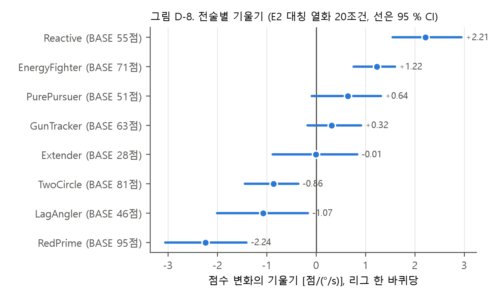
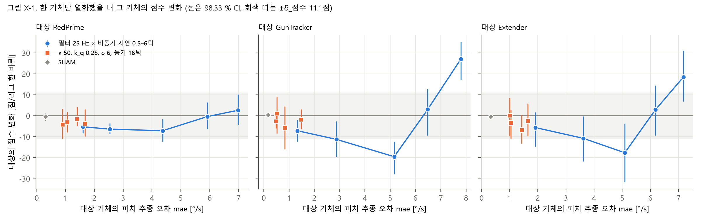
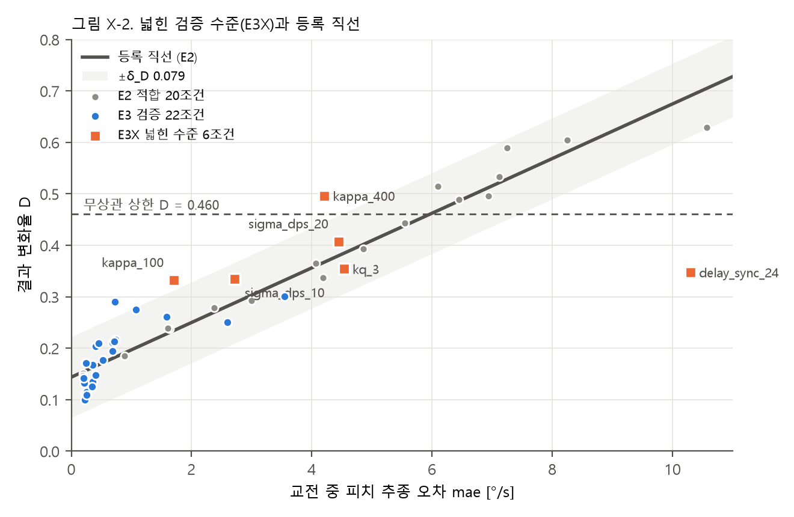

# cadet_research 검토 의견 처리 기록 — v3

> **정정 (2026-10-20, 패널 검토 P0)**: §6.2 표의 "무상관 상한 위" 판단은 편향된 상한 0.403을 썼다. 보정 상한 0.460으로는
> κ 400(0.496)만 위이고 σ 20(0.407)은 아래다. 또 §6.2의 "외삽이 아니라 원인의 문제"는 "같은 mae의 F5_D6(D 0.629)의
> 절반 정도(0.347)만 바꿨다"로 고쳐 쓴다(적합 조건 중 mae > 8은 2개뿐). 다음 처리 기록은 `FEEDBACK_FOR_CADET_v4.md`.

작성 2026-10-20. 대상: v1 검토자와 연구 책임자. 작성: 코딩 담당.
처리 대상: `FEEDBACK_FOR_CADET_v1.md`의 남은 항목 전부 — 권장 재분석 D-6~D-10, 추가 실험 E-1·E-2, 문서 수정 §6, §2.9, §7.
v2(D-1~D-5)는 그대로 둔다. 다음 검토는 v4로 새로 만든다.

**재현 방법**
- 재분석: `cd kit && python reanalysis_v3.py` (약 1분, 경기를 새로 돌리지 않음) → `kit/out/reanalysis_v3/`
- 추가 실험: `python run_extra.py` (약 7.5시간) → `kit/out/asym/`, `kit/out/e3x/`, 분석 `python analysis_extra.py` → `kit/out/extra_report/`
- 보조 분석: `kit/supplementary/README.md`

---

## 0. 한 쪽 요약

| v1 항목 | 처리 | 결과 |
|---|---|---|
| D-6 대안 예측 변수 | 완료 | 1 − 추종 상관은 적합이 더 좋지만(LOO 0.028 대 0.034) 처음 보는 원인의 예측은 더 나쁘다(E3 RMS 0.046 대 0.041, 평균 오차 +0.021). mae를 유지할 근거 |
| D-7 효용 수치화 | 완료 | mae를 D 단위 ±0.02로 재는 데 중앙값 2경기, mae가 큰 조건(≥ 4 °/s)은 25–150경기. 곡선 자체의 오차(0.034)가 더 커서 "수십 경기로 ±0.03–0.05"까지 |
| D-8 RQ4 정식화 | 완료 | 대칭 열화에서 RedPrime(1위)·LagAngler·TwoCircle은 잃고 Reactive·EnergyFighter는 얻는다(기울기 −2.24 … +2.21 점/(°/s), CI 0 밖) |
| D-9 부트스트랩 교체 | 완료 | BCa는 퍼센타일과 같고, 잭나이프 t는 약 30 % 넓다. 원인 묶음 판정은 바뀌지 않는다. k_q 0.25는 잭나이프 t에서 "실패"→"판정 불가" |
| D-10 시드 분할 교차검증 | 완료 | 처음 보는 원인 + 처음 보는 시드 예측의 E3 RMS 중앙값 0.046 (전체 시드 0.041). 원인 묶음 평균 오차는 70가지 분할 모두 ±δ_D 안 |
| E-1 비대칭 열화 (ASYM) | 완료 (10,080경기) | **사전 등록 주 판정 A2: "반대 방향"** (b = +1.59점/(°/s) [+1.08, +2.10]). 열화된 기체의 점수는 중간 열화(mae 1–5 °/s)에서 줄고(최대 −19.5점, "차이 있음") 심한 열화(mae ≥ 6)에서 오히려 는다(최대 +27.0점, "차이 있음"). 추종 오차는 성과 저하의 단조 지표가 아니다 (§6.1) |
| E-2 E3 수준 확장 (E3X) | 완료 (8,064경기) | v1의 예상대로 **κ(+0.114)와 동기 지연(−0.343)이 "예측 실패"**, σ·k_q는 성공. 동기 지연 24틱은 적합 범위 **안**(mae 10.30 < 10.57)에서 틀렸다. 외삽이 아니라 원인의 문제다 (§6.2) |
| §6 문서 수정 10건 + FLCS | 완료. 제목은 안을 올리고 연구 책임자 확인 대기 | §5 |
| §2.9 개인 폴더 경로 | 완료 | 보고서 3개 수정, 출력 코드 2곳 상대 경로로 |
| §7 `linear.json` 50 Hz 비단조 | 완료 | 공식의 전제(지연 0에서 안정)가 깨진 값이었다. "정의 불가"로 표시 (§4) |

---

## 1. D-6 대안 예측 변수 (1 − 추종 상관)

| 예측 변수 | E2 잔차 RMS | E2 LOO RMS | E3 RMS | E3 평균 \|오차\| | E3 평균 오차 [95 % CI] | E4 열화 평균 오차 | 원인별 기울기 / 적합 (κ, k_q, σ, 동기, 조합) |
|---|---|---|---|---|---|---|---|
| mae (등록) | 0.0284 | 0.0344 | 0.0411 | 0.0343 | +0.005 [−0.005, +0.014] | +0.045 | 3.82, 0.30, 1.86, 2.49, 3.27 |
| 1 − corr | 0.0254 | 0.0281 | 0.0464 | 0.0381 | +0.021 [+0.010, +0.031] | +0.046 | 2.21, 0.25, 1.40, 1.38, 0.42 |

v1의 수치(0.0254, 0.0381 대 0.0343)를 재현했다. 두 변수의 조건 순위 상관은 0.991이다.
1 − corr는 κ·σ·동기 지연의 기울기 차이를 줄이지만(3.8 → 2.2배 등) 조합과 k_q에서는 더 벌어지고, E3 전체가 위로 치우친다.
**"왜 상관이 아니라 평균절대오차인가"에 대한 답: 같은 E2로 맞췄을 때 처음 보는 원인을 더 잘 맞힌다.**

## 2. D-7 필요한 경기 수

조건마다 경기 n판을 무작위로 뽑아 그 평균 mae로 D를 예측했을 때, 1,344판 전체로 예측한 값과의 차이가 95 % 확률로 목표 안에 드는
가장 작은 n (조건마다 2,000번 추출).

| 목표 | 중앙값 | 범위 (42조건) | mae < 1 °/s | mae ≥ 4 °/s |
|---|---|---|---|---|
| ±0.02 | 2 | 1–150 | 1–15 | 25–150 |
| ±0.01 | 9 | 1–>200 | 1–75 | 100–>200 |

v1의 "10–28경기"보다 범위가 넓다. 열화가 클수록 경기마다 mae가 크게 흔들려 더 많은 경기가 필요하다.
곡선 자체의 예측 오차(E3 평균 |오차| 0.034)가 지배적이므로 논문에는 **"수십 경기로 ±0.03–0.05 정도"**로 쓴다.

## 3. D-8 전술별 기울기 (RQ4)

| 참가자 | BASE 점수 | 기울기 [점/(°/s)] (E2 20조건) [95 % CI] | 판정 | E2+E3 42조건 |
|---|---|---|---|---|
| RedPrime | 95.2 | −2.24 [−3.06, −1.41] | 잃음 | −1.83 |
| LagAngler | 46.5 | −1.07 [−2.01, −0.17] | 잃음 | −1.05 |
| TwoCircle | 81.4 | −0.86 [−1.44, −0.36] | 잃음 | −0.65 |
| Extender | 27.8 | −0.01 [−0.88, +0.83] | 판별 안 됨 | +0.11 |
| GunTracker | 63.0 | +0.32 [−0.17, +0.91] | 판별 안 됨 | +0.07 |
| PurePursuer | 51.0 | +0.64 [−0.09, +1.31] | 판별 안 됨 | +0.49 |
| EnergyFighter | 71.2 | +1.22 [+0.76, +1.60] | 얻음 | +1.74 |
| Reactive | 54.8 | +2.21 [+1.55, +2.94] | 얻음 | +1.48 |

기울기는 조건 사이의 변화만 보므로 BASE 한 번의 우연(평균으로의 회귀, v2 이전 분석에서 관찰)은 절편에 흡수된다.
BASE 점수 순위와 기울기 순위의 상관은 −0.19로 약하다. "강한 전술이 더 잃는다"는 RedPrime 하나에서만 분명하다.
**"정밀 조준형 대 단순 추적형" 가설은 분류 기준이 참가자 파일에 없어 판정하지 않았다.** 연구 책임자가 분류를 먼저 정해야 한다.

## 4. D-9 부트스트랩 교체, D-10 시드 분할, §7 50 Hz

**D-9** (원인별 평균 예측 오차, E2 재적합 포함)

| 묶음 | 오차 | 퍼센타일 | BCa | 잭나이프 t (자유도 7) | 판정 (세 방식) |
|---|---|---|---|---|---|
| κ | −0.003 | [−0.021, +0.015] | [−0.021, +0.015] | [−0.026, +0.021] | 성공 / 성공 / 성공 |
| k_q | +0.021 | [+0.001, +0.040] | [+0.000, +0.040] | [−0.005, +0.046] | 성공 / 성공 / 성공 |
| σ | +0.006 | [−0.008, +0.019] | [−0.009, +0.018] | [−0.011, +0.023] | 성공 / 성공 / 성공 |
| 동기 지연 | +0.003 | [−0.007, +0.011] | [−0.008, +0.010] | [−0.010, +0.015] | 성공 / 성공 / 성공 |
| 조합 | +0.001 | [−0.011, +0.013] | [−0.011, +0.013] | [−0.015, +0.016] | 성공 / 성공 / 성공 |
| 전체 | +0.005 | [−0.005, +0.014] | [−0.006, +0.013] | [−0.008, +0.017] | 성공 / 성공 / 성공 |

조건 하나씩: k_q 0.25는 퍼센타일 [+0.080, +0.141] 실패 → 잭나이프 t [+0.068, +0.147] 판정 불가. κ 50은 세 방식 모두 판정 불가.
v1 §2.6의 우려(구간이 좁아 "성공"이 쉬워진다)는 원리상 맞지만, **이 자료에서는 묶음 판정을 바꾸지 않았다.**
묶음 평균 오차가 δ_D보다 훨씬 작기 때문이다. 판정이 성공한 이유는 구간 폭이 아니라 δ_D의 폭이다(v1 §2.1).

**D-10** 시드 4+4 분할 70가지 (절반 A의 E2로 적합 → 절반 B의 E3를 B의 mae로 예측)

| 지표 | 중앙값 | 2.5–97.5 백분위 | \|값\| ≤ δ_D 비율 |
|---|---|---|---|
| E3 RMS | 0.046 | [0.039, 0.059] | — |
| E3 평균 오차 | +0.005 | [−0.030, +0.039] | 1.00 |
| E2 RMS (시드만 바뀜) | 0.034 | [0.028, 0.045] | — |
| 원인 묶음 평균 오차 (5묶음) | −0.003 … +0.021 | 모두 ±0.057 안 | 모두 1.00 |

v1 §2.8(E4의 참가자·시드 혼입)을 일부 대신한다. 참가자를 고정하고 시드만 바꾸면 치우침은 0 근처(중앙값 +0.005)다.
E4의 +0.045는 시드만 바뀐 70가지 분할의 97.5 백분위(+0.039)보다 크므로, **참가자 집합 때문일 가능성을 시사한다.**
다만 비교 대상 조건(E3 22조건 대 E4 5조건)과 시드 수가 달라 확정은 아니다.

**§7 `linear.json` 50 Hz**: `margin.py`의 지연 여유 공식(위상여유 ÷ 교차주파수)은 지연 0에서 폐루프가 안정할 때만 의미가 있다.
같은 파일의 특성근 검사로 보면 50 Hz는 이상 플랜트 선형 모형에서 지연 0에도 불안정하다(나이퀴스트 60 Hz에 가깝다).
4.149틱은 전제가 깨진 값이다. 비선형 벤치(실제 F-16)에서는 50 Hz도 지연 0 추종이 정상이다(J ≈ 0.41, 다른 필터와 같음).
`margin.py`를 고쳐 "여유 정의 불가"로 표시하고 `linear.json`을 다시 만들었다(3–25 Hz 값은 그대로). **물리가 아니라 모형의 한계다.**

---

## 5. 문서 수정 (v1 §6)

| # | 대상 | 처리 |
|---|---|---|
| 1 | 제목 | 뼈대 §10의 대체 제목 조항 발동. 안: 「피치 추종 오차를 이용한 공중전 결과 변화 예측과 그 적용 범위: INDI 제어 F-16 시뮬레이션 연구」. "성과"를 뺐다(대칭 D는 결과 재배열이고, ASYM에서 성과는 추종 오차에 단조가 아니다). 연구 책임자 확인 필요 |
| 2 | 뼈대 Ⅴ-C (RQ2) | "수준은 예측하지만 기울기는 원인에 따라 다르다"로 바꿈. 표 6b(기울기), 그림 D-1, 원인별 직선의 LOO 문단 추가. E3X 문장 자리 표시 |
| 3 | 기여 K2 | 동사 "조건을 밝힌다"로 결정 |
| 4 | Ⅳ-B 순환성 | v2 D-5의 시드 분할 수치(서로 다른 경기: 상관 0.969, 기울기 0.0543)로 답. 경기 수준 연결(0.032)도 함께 적고 "연결이 없다"고 쓰지 않음 |
| 5 | Ⅴ-D (E4) | 절대 D +0.045는 절편 차이, ΔD 평균 오차 0.000, SHAM은 열화 유무의 점프(ΔD로도 +0.188) |
| 6 | 한계: E3 수준 | SIG 대비 좁힘 + 2026-10-15 결정 기록 + SIG 실패를 먼저 씀. E3X 결과 자리 표시 |
| 7 | 한계: 무상관 상한 | 0.403, 적합 8/20 위, 검증 0/22. Ⅴ-B에 "포화" 대신 "개별 경기 수준에서 무정보" |
| 8 | Ⅳ-E 부트스트랩 | D-9 결과로 한계 문장 |
| 9 | 부록 재현 정보 | 실행 플랫폼 명시, 개인 폴더 경로 금지. 부록 E(재분석)·F(보조 분석)·G(추가 실험) 추가 |
| 10 | 허용폭 표기 | 머리말에 δ_D 0.079, δ_M 5.21점, δ_점수 11.10점 구분 |
| + | FLCS | `RESEARCH_PLAN.md` §5.1·§8, `PAPER_SKELETON.md` Ⅲ-B·Ⅵ-C, `kit/margin.py` 머리말. 피치·롤 내장 FLCS 법칙은 우회, 요 축만 내장 FLCS |
| + | 주장 원장 | C-01~C-06 상태 갱신, C-07(열화 유무의 점프) 신설 |
| + | Ⅴ-A·Ⅴ-B·Ⅴ-E·Ⅵ-B | 수치 채움 (δ, 기울기, 표 4, D-6, D-7, D-8) |

---

## 6. 추가 실험 (사전 등록 `PREREG_EXTRA.md`)

2026-10-19 23:44 시작 → 2026-10-20 11:15 완료. 프로세스 중단은 없었지만, 노트북이 03:38–07:06(약 3.5시간) 절전했다.
그동안 돌던 ASYM 13경기(모두 필터 25 Hz·지연 2틱, 대상 Extender, 시드 main-7)가 실시간 120초 안전장치에 걸려 `wall_clock`으로 끝났다.
사전 등록 규칙(`PREREG_EXTRA.md` §1)대로 실행기가 이 13경기를 지우고(`kit/out/asym/wallclock_removed.csv`에 보관) 다시 돌렸다.
최종 자료의 `wall_clock`은 0경기다(E3X는 처음부터 0). 결과를 본 뒤 추가한 실험이므로 본실험 판정은 바꾸지 않는다.
전체 표: `kit/out/extra_report/report_extra.md`, 그림 `fig_x1_asym.png`, `fig_x2_e3x.png`.

### 6.1 ASYM — 한 기체만 열화 (v1 E-1)

**사전 등록 판정**

| ID | 결과 |
|---|---|
| A3 교정 | SHAM에서 대상 3명 모두 "차이 없음" (−0.4, +0.4, −0.4점). 통과 |
| **A2 (주)** | Δ점수 = 대상별 절편 + b·mae, 27점. **b = +1.59점/(°/s) [+1.08, +2.10] → "반대 방향"** |
| A1 | 30칸 중 "차이 있음" 2칸(GunTracker 지연 2틱 **−19.5** [−27.9, −12.4], GunTracker 지연 6틱 **+27.0** [+17.2, +35.2]), "판정 불가" 12칸, 나머지 "차이 없음" |

**무엇이 일어났나 (사후 기술, 판정 아님)**: 점수 변화는 추종 오차에 대해 U자다.

| 대상 | 필터 25 Hz × 지연 0.5 / 1 / 2 / 4 / 6틱 (대상 mae) | 점수 변화 |
|---|---|---|
| RedPrime | 1.6 / 2.5 / 4.4 / 5.9 / 7.0 °/s | −5.2 / −6.4 / −7.1 / −0.4 / +2.6 |
| GunTracker | 1.3 / 2.9 / 5.2 / 6.5 / 7.8 °/s | −7.1 / −11.2 / **−19.5** / +3.0 / **+27.0** |
| Extender | 1.9 / 3.6 / 5.1 / 6.2 / 7.2 °/s | −5.6 / −10.8 / −17.6 / +2.9 / +18.5 |
| (필터 외 4원인, mae ≤ 1.7) | κ 50, k_q 0.25, σ 6, 동기 16틱 | −6.8 … +1.1, 모두 "차이 없음" 또는 "판정 불가" |

경기 종료 방식으로 보면(GunTracker, 336경기):

| 조건 | 대상이 상대를 격추 | 대상이 격추당함 | 대상이 지면 충돌 | 상대가 지면 충돌 |
|---|---|---|---|---|
| BASE | 94 | 117 | 30 | 67 |
| 지연 2틱 | 46 | 147 | 51 | 69 |
| 지연 6틱 | **211** | **56** | 21 | 20 |

중간 열화에서는 덜 맞히고 더 맞고 더 추락한다(예상대로의 성과 저하). 심한 열화(지연 4–6틱)에서는 반대로 상대를 두 배 넘게 격추하고 자신은 절반만 맞는다.

**가설 (검증하지 않음)**: 엔진의 기총 피해는 조준각 30° 원뿔 안에서 시간에 비례해 쌓인다
(2° 100 %, 10° 75 %, 20° 50 %, 30° 25 %, 거리 500–3,000 ft, `kit/aircombat/geometry/units.py`의 `WEZ_ATA_TIERS`).
정밀 조준이 거의 필요 없는 모델이다. 심한 지연에서 기수가 크게 진동하면, 상대 원뿔에 머무는 시간이 줄어(회피)
조준 정밀도 손실보다 이득이 커질 수 있다. 확인하려면 리플레이(ACMI)의 조준각 시계열을 봐야 한다. 이 모델에 고유한 현상일 수 있다.

**의미**
1. v1 F-1("아무도 더 지지 않았다면 성과 저하인가")에 대한 답: **한쪽만 열화하면 성과는 실제로 바뀐다.** 중간 열화에서는 점수가 떨어진다.
2. 그러나 **추종 오차는 성과 저하의 단조 지표가 아니다.** 사전 등록한 선형 판정은 반대 방향이 나왔다. 그래서 제목·초록에 "성과"를 쓰지 않는다.
3. 1위 RedPrime은 거의 흔들리지 않는다(−7.1 … +2.6). 대칭 열화(D-8)에서 가장 많이 잃은 것과 대조된다. 대칭에서 잃은 것은 자기 추종이 나빠져서라기보다 상대들이 함께 바뀌어서임을 시사한다.

### 6.2 E3X — E3 검증 수준 확장 (v1 E-2)

| 조건 | mae [°/s] | D 실제 | D 예측 | 오차 [95 % CI] | 무상관 상한 위 |
|---|---|---|---|---|---|
| κ 100 | 1.71 | 0.332 | 0.234 | **+0.097** [+0.057, +0.139] | 아니오 |
| κ 400 | 4.21 | 0.496 | 0.367 | **+0.129** [+0.105, +0.157] | 예 |
| σ 10 | 2.72 | 0.335 | 0.288 | +0.047 [+0.026, +0.069] | 아니오 |
| σ 20 | 4.44 | 0.407 | 0.380 | +0.027 [+0.002, +0.049] | 예 |
| k_q 3 | 4.54 | 0.354 | 0.385 | −0.030 [−0.059, −0.003] | 아니오 |
| 동기 지연 24틱 | **10.30** | 0.347 | 0.691 | **−0.343** [−0.370, −0.312] | 아니오 |

| 판정 (등록 규칙) | 동기 지연 | κ | k_q | σ | 전체 |
|---|---|---|---|---|---|
| X1: E3X만 | **실패** (−0.343) | **실패** (+0.114) | 성공 (−0.030) | 성공 (+0.037) | 성공 (−0.012, 상쇄) |
| X2: E3 + E3X | 성공 (−0.067) | 성공 (+0.027) | 성공 (+0.011) | 성공 (+0.016) | 성공 (+0.001) |

X4 원인별 기울기(E3 + E3X): κ 0.096(1.81배), σ 0.064(1.21배), k_q 0.025(0.46배), 동기 지연 0.019(0.35배). 모두 적합 기울기 0.0531을 CI가 배제한다.

**의미**
1. **v1 §2.3이 맞았다.** 사전 실험 수준을 넣으면 4원인 중 2개가 실패한다. E3의 "전 원인 성공"은 수준을 좁힌 결과였다.
2. **실패는 외삽 때문이 아니다.** 사전 실험에서는 동기 지연 24틱이 적합 범위 밖이라 "외삽 실패"로 설명했다. 본실험 적합 범위(0.19–10.57)에서는 안이다(10.30). 같은 mae에서 동기 지연은 결과를 훨씬 덜 바꾸고, κ는 더 바꾼다. **원인에 따른 실패**다.
3. **묶음 평균 판정의 약점이 다시 드러났다.** E3X만 보면 κ·동기 지연이 실패인데 "전체"는 상쇄되어 성공이다. E3와 합치면 저수준 조건이 묻어 모두 성공이 된다. 원인별·수준별로 보고해야 한다.

### 6.3 논문에 반영한 것 (`PAPER_SKELETON.md`)

| 위치 | 반영 |
|---|---|
| 제목 | 안 「피치 추종 오차를 이용한 공중전 결과 변화 예측과 그 적용 범위: INDI 제어 F-16 시뮬레이션 연구」 (확인 필요) |
| 초록 4·5 | E3X 실패 원인, ASYM U자 결과 |
| Ⅴ-C | E3X 표와 그림 X-2. "저수준에서는 수준이 맞지만 사전 실험 수준에서는 κ·동기 지연이 실패" |
| Ⅴ-E | ASYM 결과(그림 X-1)를 대칭 결과(그림 D-8)와 나란히 |
| Ⅵ-A | 동기 지연·κ의 실패 경로와 ASYM의 원뿔 피해 모델 가설을 "가설"로 |
| Ⅵ-C 한계 | 기총 피해 모델(30° 원뿔)의 영향, 추가 실험이 사후라는 점 |
| 주장 원장 | C-02 수정, C-06 보강, C-08(ASYM)·C-09(E3X) 신설 |

---

## 7. 연구 책임자가 정할 것

| 항목 | 선택지 |
|---|---|
| 제목 | 위 안 / "결과 불안정성"을 쓰는 안 / 다른 안 |
| RQ4 가설 판정 | 8종을 "정밀 조준형 대 단순 추적형"으로 나누는 기준 (참가자 파일에 없음) |
| ASYM 메커니즘 | 리플레이로 조준각 시계열을 확인할지(가설 검증), 후속 연구로 돌릴지 |
| 남은 추가 실험 | E-3(시드 16, 약 28시간), E-4(작은 열화 해상도, 약 5시간)는 하지 않았다 |
